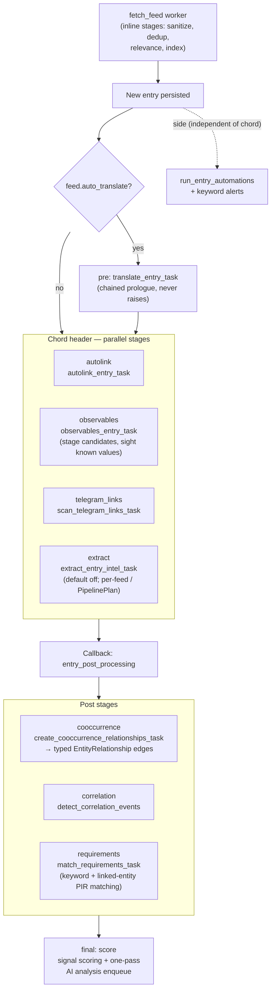

# Entry Processing Pipeline

Chord structure built by `dispatch_entry_pipeline()` (`backend/app/workers/feed_tasks.py`) from the stage registry in `backend/app/pipeline/registry.py`. Referenced from [architecture.md](../architecture.md#stage-6-task-fan-out).

Stage composition is data-driven: `PipelinePlan` rows (feed > category > global) decide which parallel stages run when the pipeline engine is enabled; otherwise the legacy `feed.auto_extract_on_ingest` boolean gates the `extract` stage.
