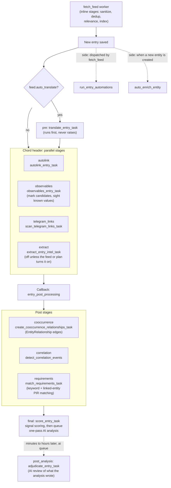

# Entry Processing Pipeline

What happens to a new article after it is saved. `dispatch_entry_pipeline()` (`backend/app/workers/feed_tasks.py`) builds a Celery chord from the stage list in `backend/app/pipeline/registry.py`. Referenced from [architecture.md](../architecture.md#stage-6-task-fan-out).

When pipeline plans are on (`pipeline_engine_enabled`), `PipelinePlan` rows (feed, then category, then global) decide which parallel stages run. Otherwise `feed_runs_extraction()` decides the `extract` stage from the feed's `auto_extract_on_ingest` and `extract_detection_rules` switches.
