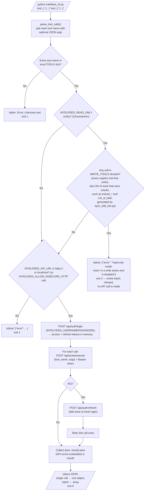

# CLI — invocation flow with read-only gating

For anyone running or changing the skill CLI. It shows how `intelfeed-skill/scripts/intelfeed_cli.py` handles one run: it checks the tool names locally, refuses write tools when `INTELFEED_READ_ONLY` is set (before any network call), checks the API URL, then logs in and runs each call, refreshing the token on a 401.

