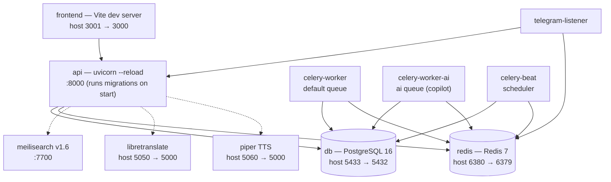

# Dev Stack Services (docker-compose.dev.yml)

Service topology for local development. Arrows follow `depends_on`; dashed lines are runtime connections configured via env URLs. Host port → container port shown where they differ.

The celery services also `depends_on` the api (service_started) — those arrows are omitted to keep the graph readable. `./docs` is mounted read-only into the api container to serve the in-app documentation.
