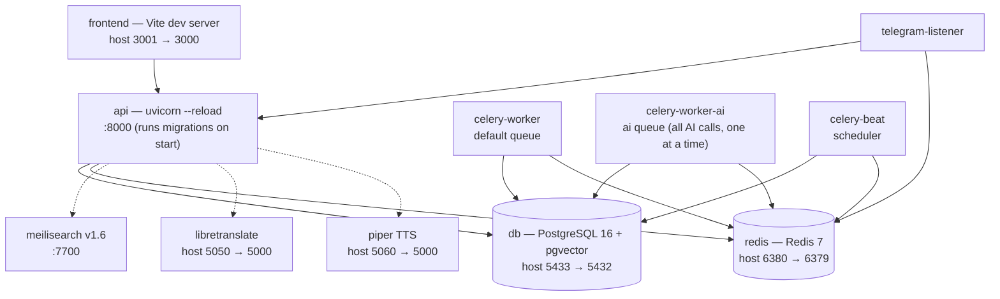

# Dev Stack Services (docker-compose.dev.yml)

The services `docker-compose.dev.yml` starts for local development. Solid arrows follow `depends_on`; dashed arrows are runtime connections set by env URLs. Ports read host → container where they differ.

The celery services also `depends_on` the api (service_started); those arrows are left out to keep the graph readable. `./docs` is mounted read-only into the api container for the in-app documentation, and `./scripts` is mounted so the utility scripts can run there.
