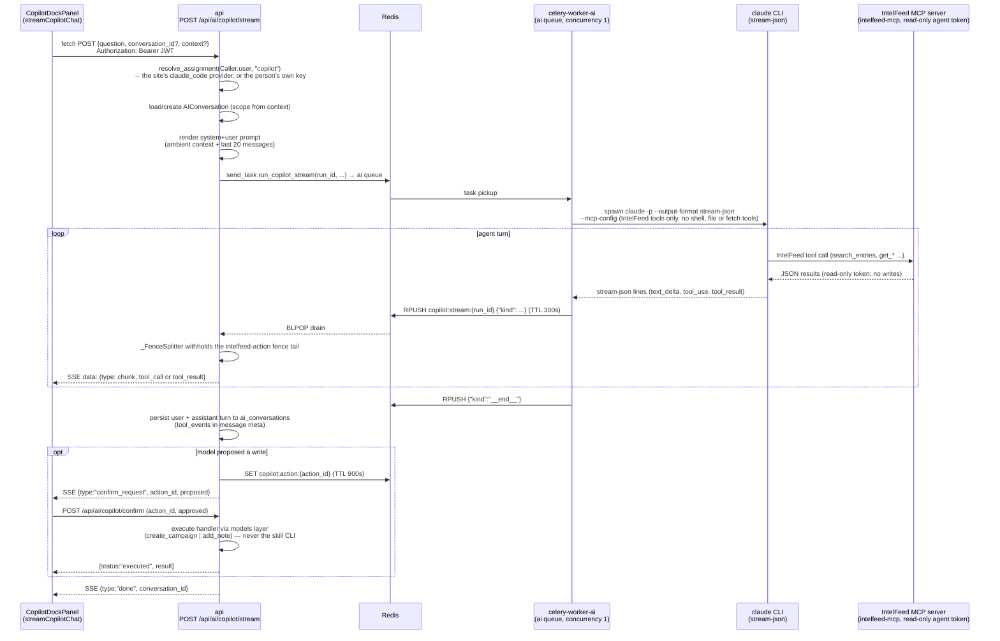

# Copilot — request and streaming flow (prod worker-dispatch topology)

For developers working on the copilot. It shows one chat turn from the dock to the Claude Code CLI and back: the api picks the provider and conversation, sends the CLI run to the `ai` queue, relays the worker's events from Redis to the browser as SSE, saves the turn, and holds any proposed write until the user confirms it. With `COPILOT_WORKER_DISPATCH=false` the api runs the CLI itself instead of using the worker.

