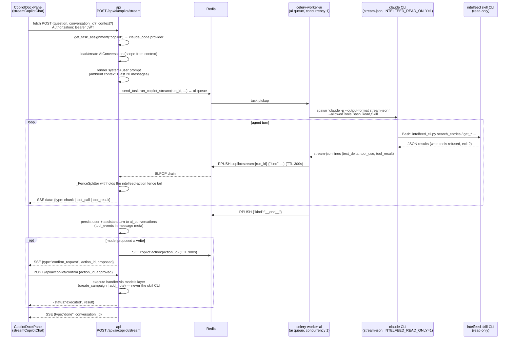

# Copilot — request and streaming flow (prod worker-dispatch topology)

How one copilot turn travels from the dock to the Claude Code CLI and back: the api resolves the task assignment and conversation, dispatches the CLI run to the `ai` queue, relays worker events from a Redis list as SSE, withholds a proposed-action fence, persists the turn, and stages any proposed write for the confirm endpoint.

