# Pipeline stage execution — plan resolution → Celery chord dispatch → run logging

How a new entry's stages are chosen and run: the feed's plan is resolved, the Celery chord is built from the stage registry, and each stage writes one run row when it finishes.

```mermaid
flowchart TD
    subgraph FETCH["Feed fetch loop (workers/feed_tasks.py)"]
        INLINE["Inline stages (kind=inline, not Celery tasks):<br/>sanitize → dedup → relevance → index"]
        INLINE --> RESOLVE["resolve_feed_plan(db, feed)<br/>pipeline/plans.py:137"]
        RESOLVE --> FLAG{"pipeline_engine_enabled?"}
        FLAG -- "off → None" --> LEGACY["Feed booleans only:<br/>run_extraction = feed_runs_extraction(feed)<br/>(auto_extract_on_ingest OR extract_detection_rules,<br/>and mode is not none)"]
        FLAG -- "on" --> CACHE{"Redis cache hit?<br/>intelfeed:pipeline_plan:{feed_id}:{version}"}
        CACHE -- "miss" --> SYNTH["synthesize_from_feed(feed)<br/>(stage defaults from the feed booleans)"]
        SYNTH --> OVERLAY["Overlay active PipelinePlan rows:<br/>global → category → feed<br/>(partial merge: enabled + config)"]
        OVERLAY --> CACHED["Cache (TTL 600s)"]
        CACHE -- "hit" --> PLAN["Resolved plan:<br/>{stage: {enabled, config}}"]
        CACHED --> PLAN
    end

    LEGACY --> DISPATCH
    PLAN --> DISPATCH

    subgraph CHORD["dispatch_entry_pipeline (feed_tasks.py:305)"]
        DISPATCH["Build chord from PIPELINE_STAGES registry"]
        DISPATCH --> PRE{"feed auto_translate?"}
        PRE -- "yes" --> TRANSLATE["Prologue (kind=pre):<br/>translate_entry_task<br/>chained ahead — never raises"]
        TRANSLATE --> HEADER
        PRE -- "no" --> HEADER["Chord header (kind=parallel,<br/>plan-gated; autolink forced if all disabled):<br/>autolink ∥ observables ∥ telegram_links ∥ extract"]
        HEADER --> CB["Chord callback:<br/>entry_post_processing (feed_tasks.py:263)"]
        CB --> POST["Second chord header (kind=post):<br/>cooccurrence ∥ correlation ∥ requirements"]
        POST --> FINAL["Second chord callback (kind=final):<br/>score_entry_task — signal scoring +<br/>one-pass AI analysis enqueue<br/>(no-op unless signal engine flags on)"]
    end

    FINAL -. "analysis lands later (ai queue)" .-> ADJ["kind=post_analysis:<br/>adjudicate_entry_task<br/>(dispatched by enqueue_adjudication)"]
    FETCH -. "independent of chord (kind=side)" .-> SIDE["automate: run_entry_automations (from the fetch task)<br/>enrich: auto_enrich_entity (when a new entity is created)"]

    subgraph OBS["Run logging (workers/pipeline_logging.py)"]
        LOG["@pipeline_stage decorator on every<br/>Celery stage task (incl. translate, automate, adjudicate):<br/>one entry_pipeline_runs INSERT per<br/>stage completion (success/error/retry)<br/>gated by pipeline_run_logging_enabled"]
        LOG --> UI["Settings → Engine: stage cards,<br/>entry processing popover, per-stage retry"]
    end

    FINAL --> LOG
    ADJ --> LOG
```

