# Entity profile assembly — data sources → entity store → config-driven profile page

For developers working on entity profiles. It shows where profile data comes from, where it is stored, which API calls read it, and how the one config-driven profile page lays it out for every entity type, campaigns included.

```mermaid
flowchart TD
    subgraph SOURCES["Data Sources (where profile data originates)"]
        direction LR
        S_AUTOLINK["Autolinker (Aho-Corasick)<br/>actors · malware · countries · vendors ·<br/>products · tools · mitigations<br/>+ junk-alias / LOLBin FP filtering"]
        S_REGEX["Regex extraction<br/>CVE-YYYY-NNNN · TNNNN(.NNN)"]
        S_AI["AI extraction<br/>one-pass analyze_entry()"]
        S_NVD["NVD API 2.0<br/>+ OSV · CVEDetails · VulnCheck"]
        S_EPSS["EPSS bulk sync (daily)"]
        S_KEV["CISA KEV sync (6h)"]
        S_GHPOC["GitHub PoC scan (daily)"]
        S_MITRE["MITRE ATT&CK sync (weekly)<br/>techniques · groups · mitigations"]
        S_MALPEDIA["Malpedia sync (weekly)"]
        S_WIKI["Wikipedia sync (weekly)<br/>+ on-demand fetch from profile"]
        S_SEED["UN country seed scripts"]
        S_COOCCUR["Co-occurrence engine"]
        S_TG["Telegram forward graph (4h)"]
        S_MANUAL["Analyst edits<br/>badge chips · descriptions ·<br/>merges · notes · confirm/reject"]
    end

    subgraph STORE["Entity Store (PostgreSQL)"]
        ENTITIES["<b>Entity tables</b><br/>ThreatActor · MalwareFamily · CVE · CWE · TTP ·<br/>Country · Sector · Tool · Mitigation ·<br/>Vendor · Product · Observable · Campaign"]
        JUNCTIONS["<b>Entry junctions</b><br/>EntryThreatActor … EntryProduct<br/>confidence · paragraph_indices · matched_names<br/>provisional dictionary-word matches held in<br/>pending_autolink_matches (AI-confirmed)"]
        RELS["<b>EntityRelationship (strength model)</b><br/>verb: uses · exploits · targets · attributed_to ·<br/>variant_of · communicates_with · delivers · drops ·<br/>related_to · successor_of · subgroup_of · overlaps_with<br/>(semantic allowlist: relationship_matrix.py)<br/>confidence: confirmed / probable / possible<br/>source · adjudication_verdict · evidence_entry_ids"]
        NOTES_T["<b>EntityNote</b><br/>title · markdown content ·<br/>note_type · tags"]
    end

    S_AUTOLINK --> JUNCTIONS
    S_REGEX --> JUNCTIONS
    S_AI --> JUNCTIONS
    S_NVD -- "CVSS · severity · vector ·<br/>CWE · CPEs · references" --> ENTITIES
    S_EPSS -- "epss_score · percentile" --> ENTITIES
    S_KEV -- "KEV flag ·<br/>exploit_availability" --> ENTITIES
    S_GHPOC -- "poc_count · poc_urls" --> ENTITIES
    S_MITRE -- "TTP metadata · mitigations ·<br/>actor group data" --> ENTITIES
    S_MALPEDIA -- "descriptions · aliases" --> ENTITIES
    S_WIKI -- "descriptions" --> ENTITIES
    S_SEED -- "name · iso_code · region ·<br/>aliases · demonyms" --> ENTITIES
    S_COOCCUR -- "source=co_occurrence edges +<br/>evidence_entry_ids" --> RELS
    S_TG -- "communicates_with edges<br/>(source=auto_extracted)" --> RELS
    S_MANUAL -- "analyst_confirmed /<br/>analyst_rejected" --> RELS
    S_MANUAL --> NOTES_T
    S_MANUAL --> ENTITIES

    subgraph API["Backend API Layer"]
        PIVOT["GET /intelligence/pivot/{type}/{id}<br/>entity + related + entries"]
        GRAPH["GET /intelligence/graph/{type}/{id}<br/>?depth&window_days → nodes + typed edges"]
        TIMELINE["GET /intelligence/timeline/{type}/{id}<br/>correlation events"]
        REL_API["/entity-relationships<br/>list · create · update ·<br/>confirm · reject"]
        ENTITY_API["Per-type entity CRUD +<br/>POST /entities/{type}/merge ·<br/>duplicates · merge-suggestions"]
        NOTES_API["/entity-notes CRUD"]
        EXPORT_API["GET /export/entities/{type}/{id}<br/>POST /export/entities/bulk (ZIP, ≤500)"]
        SCAN_API["POST /autolink/scan<br/>entity mentions in free text"]
        CACHE["Redis cache<br/>intelfeed:corr:pivot3:* · intelfeed:corr:graph3:*<br/>TTL: correlation_cache_ttl_seconds"]
    end

    ENTITIES --> PIVOT
    JUNCTIONS --> PIVOT
    RELS --> GRAPH
    JUNCTIONS --> GRAPH
    ENTITIES --> TIMELINE
    RELS --> REL_API
    ENTITIES --> ENTITY_API
    NOTES_T --> NOTES_API
    PIVOT --> CACHE
    GRAPH --> CACHE

    subgraph PAGE["EntityProfilePage (single config-driven shell)"]
        CONFIG["<b>entityProfileConfig.tsx</b><br/>per-type declaration of tabs ·<br/>signal badges · identity fields ·<br/>overview panels · external links"]
        HEADER["<b>ProfileHeader</b><br/>breadcrumb · type badge · name<br/>SignalBadges: click-to-edit chips<br/>(motivation · country→profile link ·<br/>malware_type · severity/CVSS/EPSS/KEV ·<br/>tactic · region · vendor/product type)<br/>Ask Copilot · enrichment status ·<br/>actions menu (export MD · merge into ·<br/>watchlist · add to campaign · convert type)<br/>meta: article_count · first/last_seen"]
        TAB_OVERVIEW["<b>Overview tab</b><br/>description (EntityLinkedMarkdown —<br/>entity mentions rendered as profile links)<br/>identity fields · activity feed · assessment ·<br/>known associates · essential reading ·<br/>per-type panels · next-actions rail ·<br/>AI analysis (AIAnalysisModule) ·<br/>Context (ContextPanel: enrichment sources,<br/>CVSS by source) · notes (EntityNotesSection)"]
        TAB_RELS["<b>Relationships tab</b><br/>EntityGraph (custom SVG, typed edge labels,<br/>drag/pivot/inspect; claims-only) + rows split into<br/>claims (typed verbs, graded by trust) and<br/>co-mentions (shared reporting, not claims):<br/>verb · evidence count · sparkline · confirm/reject ·<br/>enrichment source tags · via-source filter ·<br/>unresolved names"]
        TAB_DETECT["<b>Detection tab</b><br/>linked detection rules · coverage<br/>(Detection Gaps opens as an extra tab<br/>from the rail's Review gaps action)"]
        TAB_VULN["<b>Vulnerabilities tab</b><br/>(cwe · vendor · product)<br/>CVEs with this weakness, or affecting<br/>CVEs via cve_affected (NVD CPEs,<br/>CVE record affected list)"]
        TAB_WEAK["<b>Weaknesses tab</b><br/>(cve only)<br/>CWEs linked to the CVE"]
        TAB_GEO["<b>Geography tab</b><br/>(country only)<br/>role breakdown · origin/targeting actors"]
        TAB_VICT["<b>Victimology tab</b><br/>(sector only)<br/>who targets this industry ·<br/>leak-site victims"]
    end

    CONFIG -- "declares tabs per type:<br/>threat_actor · malware · ttp · campaign →<br/>overview · relationships · detection<br/>cve → overview · weaknesses · relationships · detection<br/>cwe → overview · vulnerabilities · relationships · detection<br/>vendor · product → overview · vulnerabilities · relationships<br/>country → overview · relationships · geography<br/>sector → overview · victimology · relationships<br/>tool · mitigation · observable → overview · relationships" --> HEADER

    PIVOT --> TAB_OVERVIEW
    TIMELINE --> TAB_OVERVIEW
    GRAPH --> TAB_RELS
    REL_API --> TAB_RELS
    ENTITY_API --> HEADER
    EXPORT_API --> HEADER
    NOTES_API --> TAB_OVERVIEW
    SCAN_API --> TAB_OVERVIEW


    style SOURCES fill:#0d1117,stroke:#58a6ff,color:#c9d1d9
    style STORE fill:#161b22,stroke:#7ee787,color:#c9d1d9
    style API fill:#0d1117,stroke:#8b949e,color:#c9d1d9
    style PAGE fill:#161b22,stroke:#f78166,color:#c9d1d9
```

