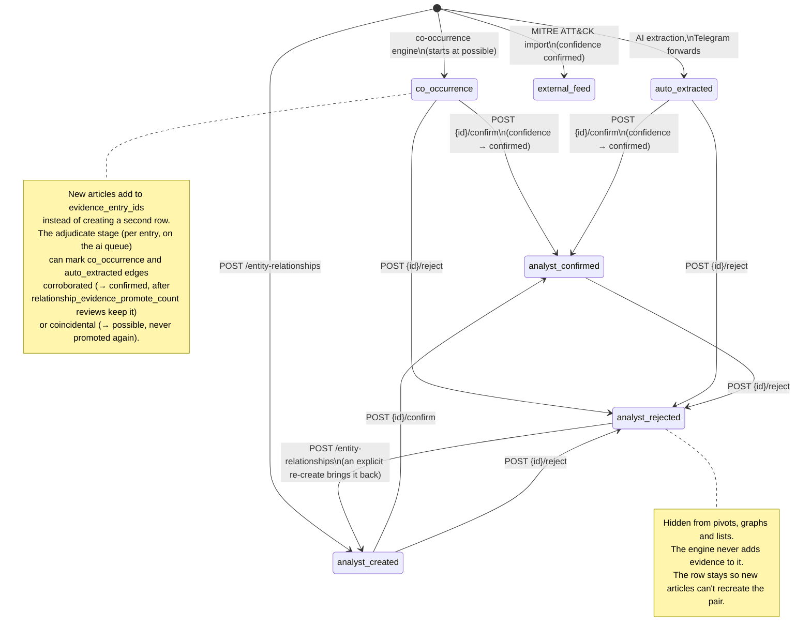

# Entity Relationship Lifecycle

For analysts and developers working with typed relationships (`/api/entity-relationships`). It shows how an edge's `source` (who asserted it) changes over its life. Confidence (`confirmed` > `probable` > `possible`) moves separately, except that confirming an edge also sets its confidence to `confirmed`.

Every write path (co-occurrence, AI extraction, copilot tools, the REST API) checks the `(source_type, verb, target_type)` triple against the allowlist in `backend/app/intelligence/relationship_matrix.py`. An assertion written the wrong way round is flipped to the allowed direction.

Referenced from [`docs/api-reference.md`](../api-reference.md) (Entity Relationships section).
