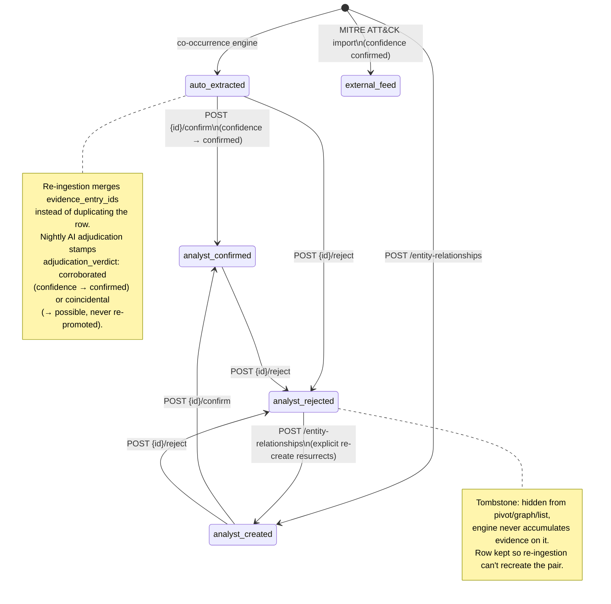

# Entity Relationship Lifecycle

Provenance (`source`) lifecycle for typed entity relationships (`/api/entity-relationships`). Confidence tiers (`confirmed` > `probable` > `possible`) are orthogonal, except that confirming forces `confidence: confirmed`.

All write paths (co-occurrence, AI extraction, copilot tools, the REST API) validate the `(source_type, verb, target_type)` triple against the semantic allowlist in `backend/app/intelligence/relationship_matrix.py`; reversed assertions are flipped to the allowed orientation.

Referenced from [`docs/api-reference.md`](../api-reference.md) (Entity Relationships section).
