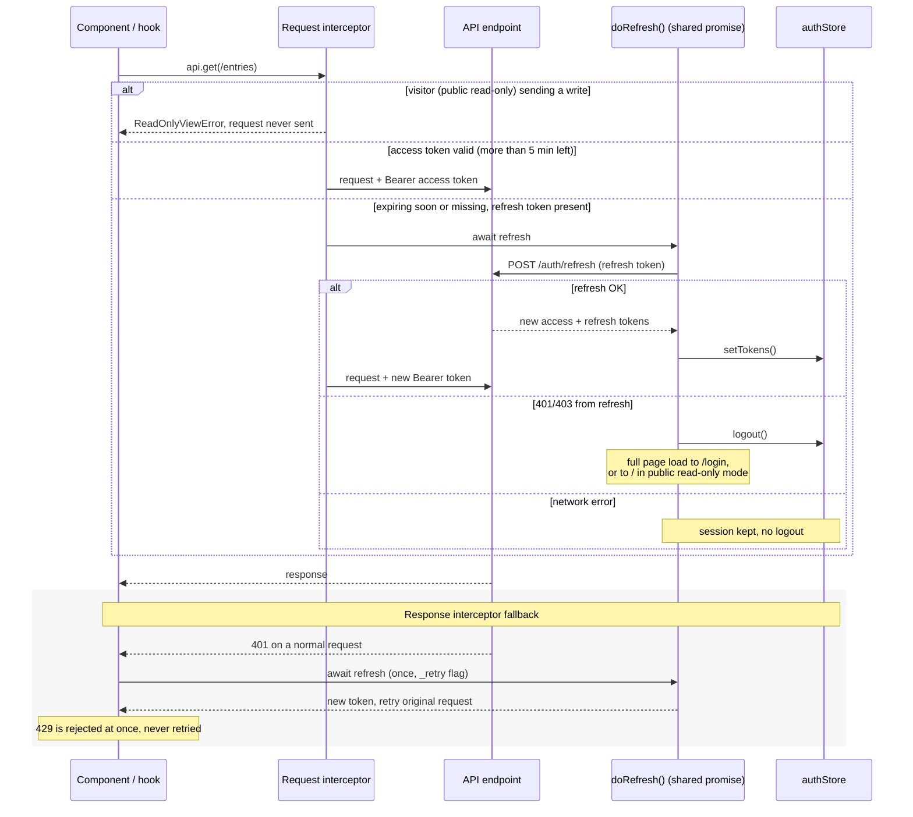

# Frontend JWT Refresh Flow

How the browser keeps a user signed in (`frontend/src/api/client.ts`). Several requests that need a new token at once share one refresh call (`doRefresh`). The user is signed out only when the refresh endpoint itself rejects the refresh token with 401 or 403.

