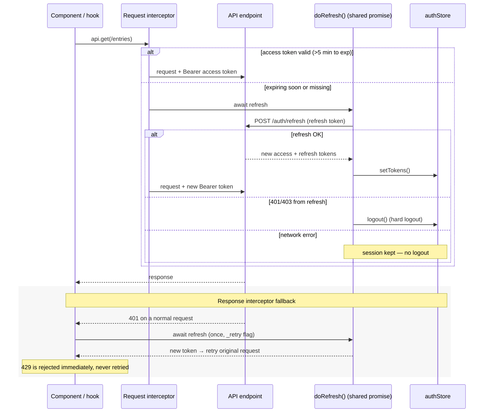

# Frontend JWT Refresh Flow

Sequence of token handling in `frontend/src/api/client.ts`. Concurrent refresh
attempts are deduplicated through a single shared promise (`doRefresh`), and a
hard logout happens only when the refresh endpoint itself rejects the refresh
token with 401/403.

