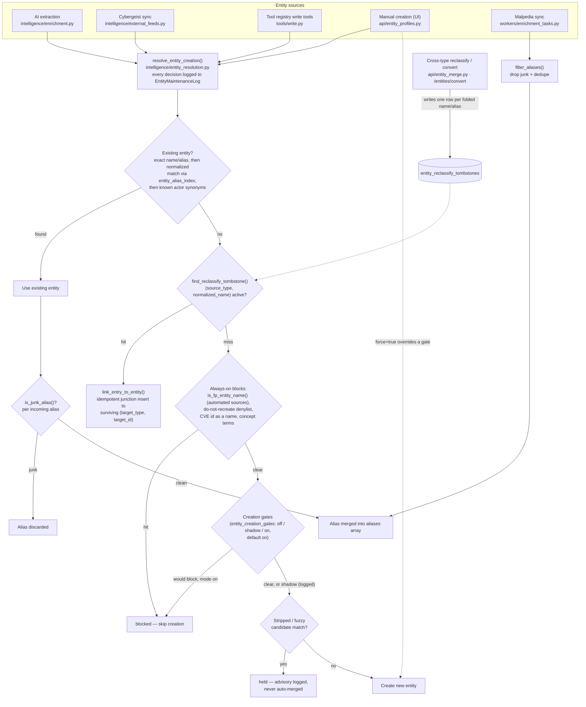

# Entity creation guards: resolver gates, junk-alias filtering and cross-type resurrection suppression

The checks a new entity name passes, in order, before `resolve_entity_creation()` lets a row be created: duplicate matching, reclassify tombstones, the always-on junk blocks, the switchable gates, and alias filtering.

Notes:
- Vendor, Product, Tool, and Mitigation names skip the false-positive name set in the autolinker vocabulary, so real vendors (such as Norton) still match.
- Same-type merges survive re-import through the survivor's `aliases` array; tombstones cover the cross-type case.
- Set `active=False` on a tombstone row to allow a deliberate split later.
- A manual create that a check refuses returns `entity_creation_gated`; retrying with `force=true` creates it anyway and logs the override.
