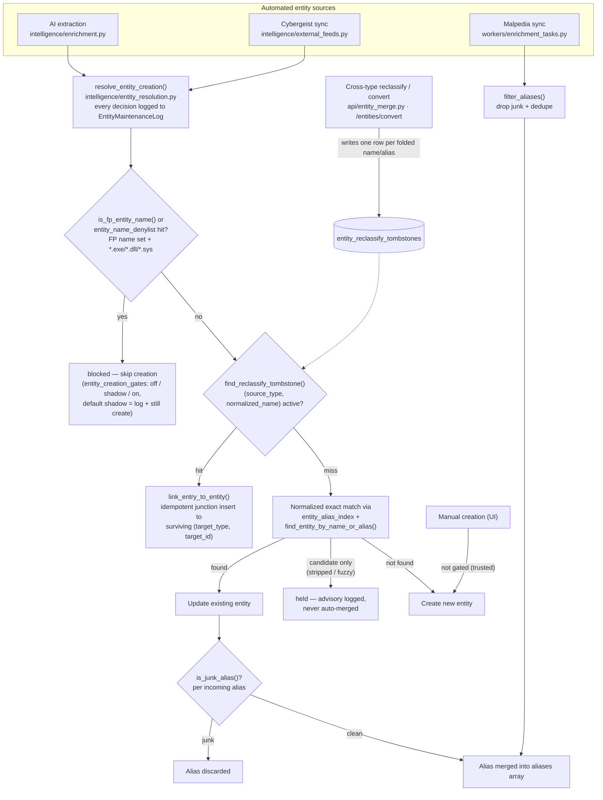

# Entity creation guards: resolver gates, junk-alias filtering and cross-type resurrection suppression

Notes:
- Vendor, Product, Tool, and Mitigation names deliberately bypass the FP name set in the autolinker vocabulary so legitimate vendors (e.g. Norton) still match.
- Same-type merges already survive re-import via the survivor's `aliases` array; tombstones only close the cross-type gap.
- Set `active=False` on a tombstone row to re-allow a deliberate split later.
- `entity_creation_gates` lives in system_settings: `shadow` logs the would-block/would-hold decision and still creates; `on` enforces it.
