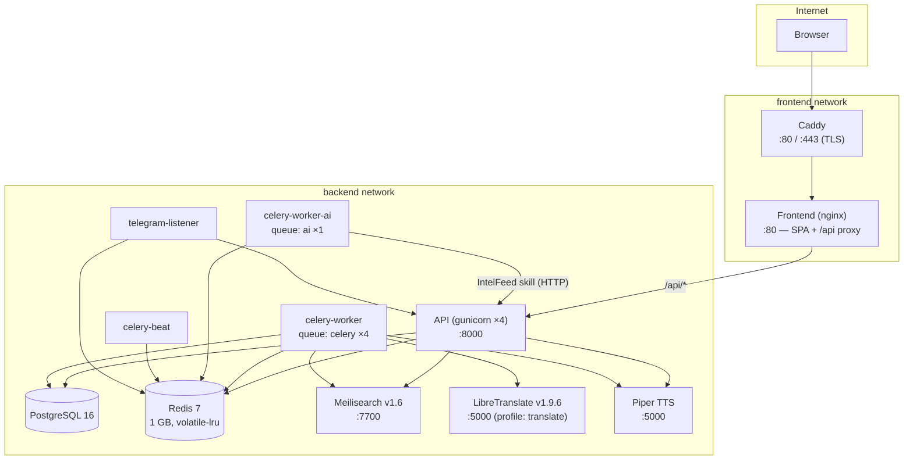

# Production Service Topology

Docker Compose service graph for `docker-compose.prod.yml`. Only Caddy is exposed to the internet; the `frontend` and `backend` Docker networks isolate the reverse-proxy path from the data services.

Notes:

- The API never runs the Claude CLI itself — global copilot turns are enqueued on the `ai` queue and executed by `celery-worker-ai`, which is the sole owner of the OAuth credentials volume. The service is behind the `claude_code` compose profile — a plain `up -d` / `update.sh` does not start it.
- LibreTranslate is called by the Celery translation tasks. It is behind the `translate` compose profile (on-demand); while it's down, the `retry_untranslated_entries` beat task backfills once it returns.
- Piper (text-to-speech) is called over HTTP by both the API (on-demand read-aloud) and the Celery TTS tasks (pre-generation + caching).
- Healthcheck ordering: db + redis must be healthy before the API starts; the API must be healthy before frontend, telegram-listener, and (transitively) Caddy start.
