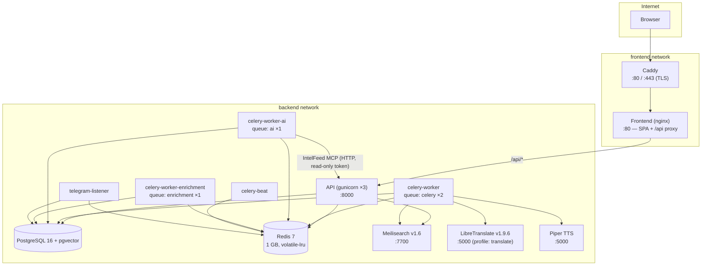

# Production Service Topology

The services in `docker-compose.prod.yml` and how they connect. Only Caddy is reachable from the internet; the `frontend` and `backend` Docker networks keep the proxy path apart from the data services.

Notes:

- The API never runs the Claude CLI itself. Copilot turns and every other AI task go on the `ai` queue, which only `celery-worker-ai` serves, one task at a time. That worker is the only one that mounts the CLI credentials volume.
- LibreTranslate is behind the `translate` compose profile, so a plain `up -d` does not start it. Celery translation tasks call it; the `retry-untranslated-entries` job catches up on missed entries once it is back.
- Piper (text-to-speech) is called only by the Celery TTS task. The API queues the synthesis and serves the cached MP3.
- Start order: db and redis must be healthy before the API and workers start; the API must be healthy before the frontend and telegram-listener; the frontend must be healthy before Caddy.
