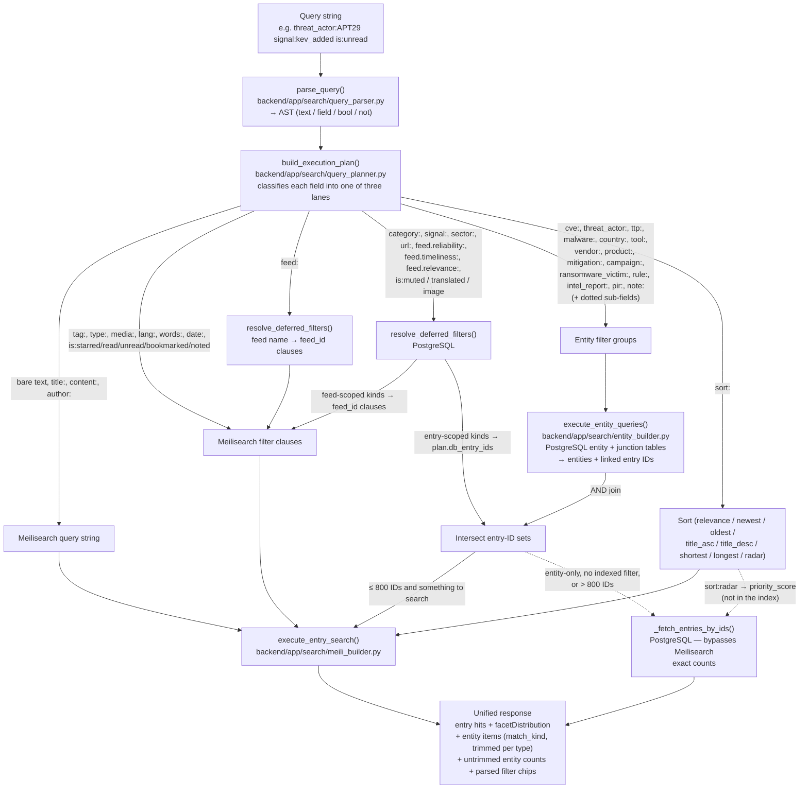

# Query Routing Flow

How a unified search query travels from the search bar to results. Referenced from
[docs/query-language.md](../query-language.md) ("How Queries Route").

Three lanes, not two: indexed entry fields go to Meilisearch, entity fields go to the
entity tables, and a middle group (`category:`, `signal:`, `sector:`, `url:`, feed
grades, `is:muted/translated/image`) is answered from PostgreSQL because those columns
are not in the search index and adding them would mean re-indexing every document.

Feed-scoped PostgreSQL filters resolve to a few hundred feed IDs and become ordinary
Meilisearch clauses. Entry-scoped ones resolve to a set of entry IDs that intersects
with the entity join — one `IN` list instead of thousands of OR clauses.

Join semantics: entity results constrain entry results (AND) by default; an `OR`
between an entry predicate and an entity predicate switches the plan to OR mode,
returning the union instead.

Negation of an entry-scoped PostgreSQL filter is subtractive only — the complement is
every other entry, which is unbounded — so it removes matches from a positive set and
does nothing on its own.
