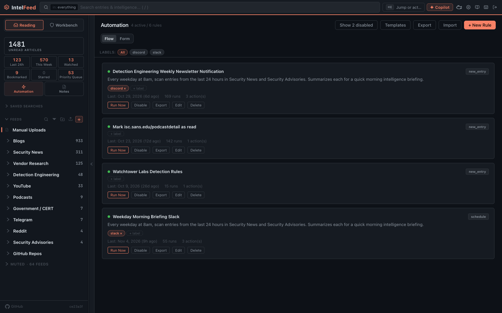

# Automation and AI

This page covers automation rules, which run tasks for you, and the copilot, an
AI assistant you can ask questions. The copilot and AI actions need an AI
provider set up by an admin; rules without AI actions work without one.

*Automation rules, each with its trigger, label, and run history.*

## Automation rules

Click **Automation** in the Reading sidebar, then **+ New Rule**. A rule has a
trigger, optional conditions, and one or more actions. **Templates** starts from
a ready-made rule, and **Import** / **Export** move rules between instances.

**Triggers:**

- New entry arrives
- Entry scored
- Observable captured (a new IOC, such as a bad IP or file hash)
- On schedule (cron)
- Keyword match
- CVE detected
- Manual trigger (the rule's **Run Now** button)

**Conditions:** the feed or feed type, words in the content, severity, author,
tags, read/starred/bookmarked state, whether it has a note, its priority score
or signals, whether a watched entity is mentioned, and whether it has a
captured IOC.

**Actions**, among others:

- run an AI task, or extract TTPs, CVEs, threat actors or malware
- generate detection rules
- add or remove tags
- send a notification to Slack, Discord or a custom webhook (the URL is set on
  the action)
- add to a campaign, or track on the Threats board
- mark read, star, bookmark, mark priority, or hide
- create a note or an intel report
- chain another rule, or branch with if/else

### Worked example

> **Auto-Sigma on critical CVE**
> Trigger: CVE detected
> Condition: Severity above 9.0
> Actions: Extract TTPs → Generate Detection Rules (Sigma) → Add Tags
> `auto-rules` → Send Notification to Slack

A critical CVE then gives you a draft rule and a Slack message.

### Before you enable it

**Start small.** One missing condition can turn two messages a day into two
hundred. There is no dry run: **Run Now** runs the rule for real on recent
articles (by default up to 50 from the last 24 hours). Try a new rule with a
harmless action, such as adding a tag, before adding the notification.

**Watch the logs.** **Settings → Logs → Automation** (admin only) shows every
run: the rule, the time, whether the conditions matched, which actions ran, and
any errors. Check each action's status: a run can report success while one action
failed.

## The copilot

A chat panel that docks on the right of every page. Open it with the
**Copilot** button in the header, or `Ctrl+Shift+K` (`⌘⇧K` on a Mac).

It uses tools to search your articles, look up entities and read these docs,
each shown as a chip. An
answer with no tool chips came from the model alone, not your data.

**Context.** A pill shows what it is looking at, such as the open article.
**Ask Copilot** buttons open it focused on one thing. Remove the pill to ask
about everything.

**Changes need your OK.** The copilot can do most things you can do: make a
campaign, add a note or tag, watch an entity, and (for admins) merge or delete.
It only proposes them. Each change shows up as a card with the exact action and
its details, and nothing happens until you click **Confirm**. Deletes and
admin-only changes get a warning line. It never gets tools your account can't
use.

**Conversations** are saved. **History** reopens old ones. **Share** makes a
public read-only link (see [Notes and sharing](notes-and-sharing.md#share-links)).

**On the documentation page**, a second copilot, "Ask about IntelFeed", answers
"how do I…" questions from the guide and developer docs and cites its page.

Good uses: "what's trending in the last 24 hours", "which CVEs in our feeds are
known to be exploited". Check numbers,
attribution, and anything going into a report.

## AI features elsewhere

- **Article summaries** above the article text in the reader.
- **Daily summaries** on the day dividers. These are shared, so regenerating
  one uses AI for everyone.
- **Entity extraction** when articles arrive, which fills profile pages.
- **The AI panel** (`a`) in the reader, with tasks to run on the open article
  and **Ask Copilot**.
- **Report and rule drafting**, covered in
  [Campaigns and reports](campaigns-and-reports.md) and
  [Writing detection rules](detection-rules.md).

## Your own key

If your admin allows it, **Settings → My AI** lets you add your own AI key, of
the types your admin allows (for example OpenAI-compatible, Claude API or
Ollama). Tasks you start yourself (copilot, rule drafts, summaries, reports) can then
run on your key.

- Set a default key, or pick one per task. **Instance default** sends that task
  back to the instance's provider.
- The page shows this month's spend and today's requests. Set your own monthly
  cap, and turn off **Fall back to the instance's providers** if you never want
  the instance to answer for you.

Two things to know:

- The copilot has the same tools on your key as on the instance's. The one
  exception is an OpenAI-compatible key with **Tool calling** turned off; the
  dock then shows **no tools**.
- Automation rules, share links and background processing never use your key,
  even under your name. Each result says who answered: your key, the instance,
  or a fallback and why.

## Providers and cost (admin)

**Settings → AI Configuration** has four tabs:

- **Providers**: the AI services the instance can use, and which model runs
  which task.
- **Prompts**: the editable instructions for each task.
- **User keys**: whether people may add their own keys (Off, Optional or
  Required), which types, whether private network addresses are allowed, the
  daily limits (per user's own key, per user on the instance's providers, and
  per share link), which prompts a personal key may answer, and everyone's keys
  (you can disable or delete them, not use them).
- **Cost Dashboard**: tokens and spend per provider, task and person, split
  between the instance and people's own keys.

Run everything locally on Ollama, on a hosted API, or a mix: cheap bulk work on
a local model, analysis on a stronger one.

**Adding a provider does not turn AI on by itself.** Each task needs an
assignment naming a provider and a model. The AI step in the onboarding tour
tests the provider and assigns the tasks for you. After that, change
assignments on the Providers tab.

Tasks that use tools, such as the copilot, run on any provider type: Claude
Code, the Claude API, OpenAI-compatible and Ollama. An OpenAI-compatible
provider has a **Tool calling** switch in its Configure panel; turn it off for a
local server that handles tools badly, and those tasks can't be assigned to it.
On the copilot's page in **Prompts**, **Skip Confirm for** picks low-risk
changes, such as notes and tags, that run without the click. It is empty by
default; deletes and admin-only changes always ask. The copilot on the
documentation page only looks things up.

On the Cost Dashboard, a copilot on a flat-rate sign-in shows what the tokens
*would* cost at API prices, not a real charge. The real limit is the plan's
quota.

If extraction keeps making the same mistake, one sentence in its prompt usually
fixes it.

Next: [Notes and sharing](notes-and-sharing.md)
