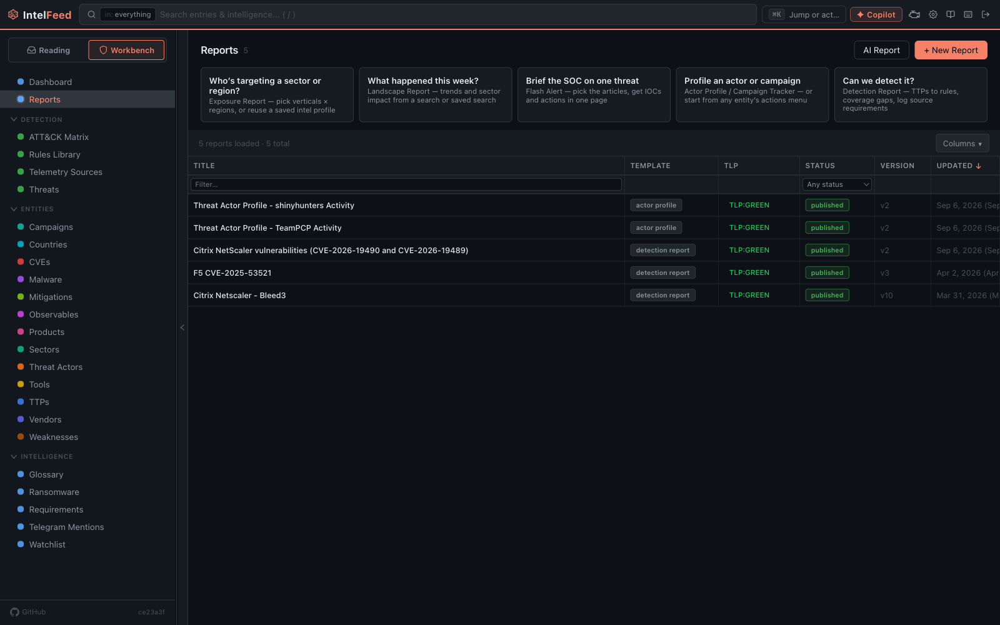

# Campaigns and reports

A **campaign** keeps an investigation together while you work on it. A
**report** is how you hand the results to someone else. This page covers
creating and filling a campaign, and writing, versioning and exporting a report.

AI drafting in reports needs an AI provider. Everything else works without one.

*Reports start from a template and carry a TLP marking and version history.*

## Campaigns

A campaign groups articles, entities and detection rules under one name, such as
"LockBit Q3" or "the Fortinet thing".

### Creating one

Go to **Workbench → Campaigns** and click **+ New**. Fill in:

- **Name**: what you'd call it out loud.
- **Description**: why you're tracking it. Write it now; you won't remember in
  three weeks.
- **Status**: active, monitoring, closed or historical.
- **TLP Marking**: the Traffic Light Protocol label that tells readers how far
  they may pass it on: CLEAR, GREEN, AMBER, AMBER+STRICT or RED. The default
  is GREEN.
- **Tags**: comma-separated.

**✦ Discover** asks the AI to suggest campaigns from recent articles. It needs
an AI provider.

### Filling it

Add things as you find them:

- **An article:** in the reader, open the intel panel (`w`) and click
  **+ Campaign**, then pick the campaign.
- **An entity:** on its profile, open the **⋯** menu and choose
  **Add to campaign**.
- **A steady stream:** on the campaign's profile, **Add intake** follows a
  search query, an entity or a story, so new matching articles join the campaign
  on their own. The **Could take** list suggests more articles you can add once
  or follow.

### The campaign page

A campaign has a profile page like any other entity, with **Overview**,
**Relationships** and **Detection** tabs. The overview shows its activity over
time, its linked entities and what feeds it. The Detection tab shows which of
its techniques your rules cover.

### Exporting

The profile's **⋯** menu has **Export as Markdown** and **Generate report**.

## Reports

Go to **Workbench → Reports**. You can start in three ways:

- **+ New Report** opens a blank report where you pick a template.
- **AI Report** drafts a report with AI from a search or saved search.
- The starter cards ("What happened this week?", "Brief the SOC on one threat"
  and so on) open the right template for a common question.

The templates:

| Template | For |
|---|---|
| Flash Alert | Breaking news: summary, key findings, indicators, actions |
| Threat Actor Profile | One group in depth: aliases, TTPs, targets, infrastructure, timeline |
| Campaign Tracker | One incident: overview, attack chain, indicators, TTPs, affected systems |
| Threat Landscape Report | A period snapshot: trends, notable threats, vulnerabilities, sector impact |
| Threat Exposure Report | Which threats target a chosen set of regions and sectors |
| Detection Engineering Report | Your rules, coverage gaps, log sources needed, recommendations |

Each template has its own AI prompt. An admin can edit these under
**Settings → AI Configuration → Prompts**.

### Exposure reports and intel profiles

A threat exposure report starts from an **intel profile**: a saved, named scope
of regions and sectors (**Verticals**) with a time **Window**. Keep one per
customer, portfolio or area you watch, and reuse it each time you report.

Click the "Who's targeting a sector or region?" card to open the exposure
builder. It finds the actors and malware active against that scope and shows
why each one matched: the matched regions (marked "claimed" when a source says
so directly), the matched sectors, the number of tracked ransomware victims, and
the number of articles.

Something that matched only regions or only sectors is marked **partial match**
and ranked lower. Click **Keep** or **Drop** on each. Your choices are saved on
the profile, so next time you aren't asked again about what you dropped.

### Writing one

The template sets out the sections. Edit them in Markdown. Insert snippets
(**TTP Matrix**, **Timeline**, **Recommendations**, **Detection Guidance**)
instead of building those by hand. **Generate with AI** drafts a section.

To add material while you work elsewhere, use **Send to report**. It is in the
entry list's selection toolbar (**Report**), the AI panel in the reader
(**Report**), an entity profile's menu, and the Threats board. It adds the
material to a draft without leaving the page.

Read every AI-written sentence with care. AI is good at structure, and also
states guesses with confidence. Treat it like a first draft from a junior
analyst in a hurry.

Each save that changes the text keeps the earlier version. **Version History**
lists them, and you can open one to read it.

### TLP

Set TLP on purpose. It is a promise to whoever gave you the information.
Marking everything AMBER "to be safe" makes the label meaningless. IntelFeed
shows the marking on the report and its exports, but it does not stop you from
sharing anything: that is up to you.

### Exporting

Markdown, HTML or PDF. Use Markdown for a wiki and PDF for an attachment.

For more on what leaves IntelFeed and how, see
[Notes and sharing](notes-and-sharing.md).

Next: [Automation and AI](automation-and-ai.md)
