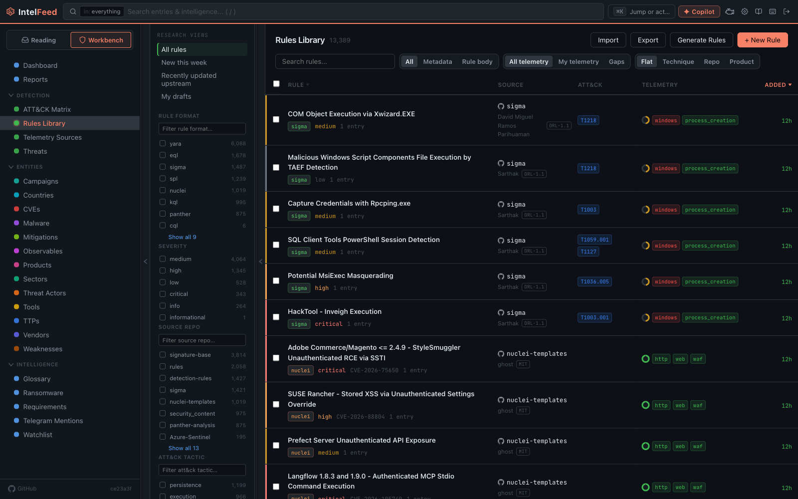

# Writing detection rules

A detection rule is a search or pattern your security tools run to spot an
attack. This page covers drafting, editing and storing rules. Drafting with AI needs an AI provider; writing
and storing rules by hand does not.

*The rule library, filterable by the telemetry you actually collect.*

## Formats

IntelFeed checks the syntax of nine formats:

| Format | Where it runs |
|---|---|
| Sigma | Vendor-neutral YAML, converted for your SIEM |
| Splunk SPL | Splunk |
| CrowdStrike QL | CrowdStrike Falcon |
| Elastic QL | Elastic |
| KQL | Microsoft Sentinel / Defender |
| Snort / Suricata | Network intrusion detection |
| YARA | File and memory scanning |
| Nuclei | Vulnerability scanning templates |
| Panther | Panther |

Not sure? Use Sigma; it converts to most tools.

## From an article to a rule

Rules and search queries already in an article are pulled out and shown on it.
To draft one yourself:

- Press `a` for the AI panel. If the article names techniques or CVEs but has
  no rules, a suggestion reads "N TTPs but no detection rules". Click
  **Gen Rules →** to draft a Sigma rule and a Splunk SPL rule, saved to the
  library as drafts.
- Or open the intel panel (`w`) and click **Gen Rules**.
- Or use a threat's button on the **Threats** board. See [The Threats board](threats-board.md).
- Or go to **Workbench → Rules Library → Generate Rules**. Pick articles,
  formats and an **Analysis Focus** (Auto-detect, Campaign, Vulnerability,
  Malware or Threat Actor), then click **Generate Analysis**. You get the
  indicators, the ATT&CK techniques, and how detectable each step is with
  ordinary logs.

**A draft is only a draft.** The AI doesn't know your environment. Review it.

## The editor

Open a rule from the library, or click **+ New Rule**. The editor highlights
syntax and flags errors as you type.

Side panels: **Details** (severity, description, tags, MITRE tactics, analyst
notes), **AI Assist**, **Convert** (to another format), **History**, and
**Compare**. Click **Save** to keep your changes.

Write a real description: in six months it is the only record of why the rule
exists.

## Drafts and versions

New and generated rules start as **Draft**. Click the **Draft** button to mark a
rule **Published** when it is ready.

Each save keeps the earlier version. To go back, open one in the **History**
panel and click **Rollback to this version**.

## The library

**Workbench → Rules Library** lists every rule. Search, or filter with the side
rail by format, severity, tactic, technique, log source, repository, license,
tags, and linked actors, malware, tools, vendors and products.

Two values in the same filter widen the list (either matches). Values in
different filters narrow it (all must match).

**Import** loads rules from files.

## Coverage and gaps

**Workbench → ATT&CK Matrix** shades each technique by how often your feeds
report it and whether you have a rule for it.

In **Workbench → Telemetry Sources**, tick the log sources you collect.
IntelFeed compares each rule's required sources with your list, so you can tell
"we have no rule" from "we have a rule that can't fire here".

## Exporting

- **One rule:** **Export ↧** downloads it in its own format (`.yml`, `.spl`,
  `.kql`, `.yar`, and so on). **Copy** puts it on the clipboard.
- **Many rules:** **Export** in the library header downloads all rules as a ZIP,
  or only the selected rows.
- **Coverage:** **Export Navigator JSON** on the ATT&CK Matrix downloads a layer
  for MITRE's ATT&CK Navigator.

Rules can also go into reports. See [Campaigns and reports](campaigns-and-reports.md).

Next: [Campaigns and reports](campaigns-and-reports.md)
