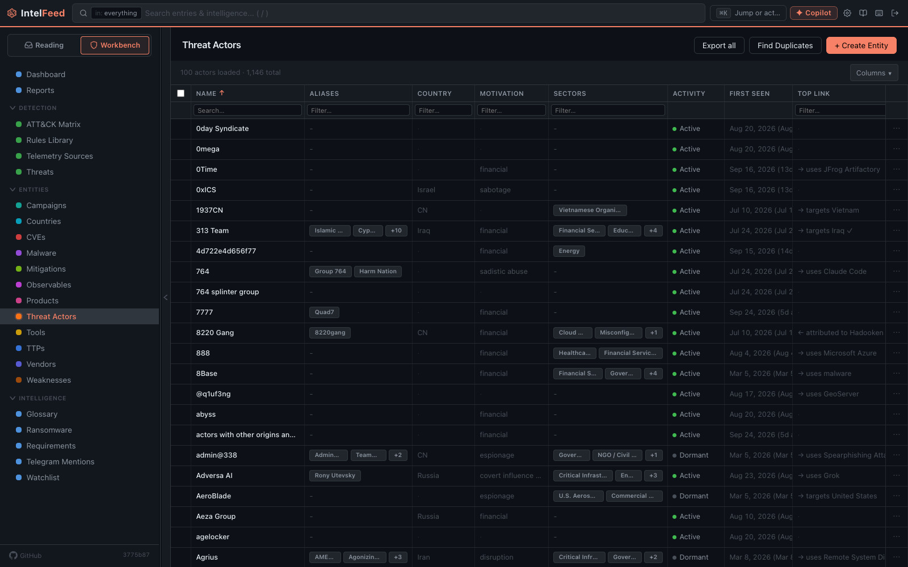
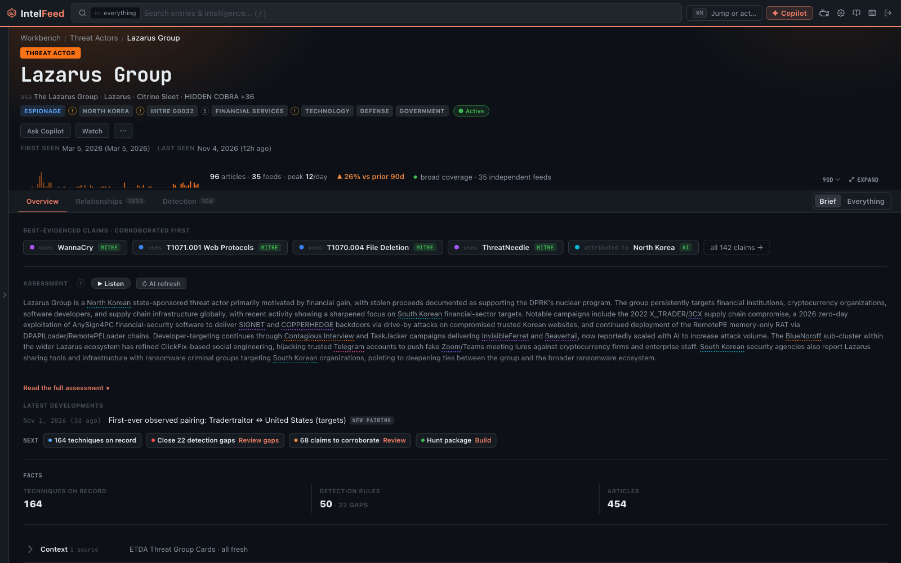

# Entities and profiles

An **entity** is a named thing IntelFeed tracks across many articles, such as
an actor, malware family or CVE. This page covers profiles, watching, and
fixing mistakes. The types:

- **Threat actor**: a group or person behind attacks, such as APT29.
- **Malware**: a family of malicious software, such as LockBit.
- **CVE**: a public ID for a known software flaw, such as CVE-2026-1234.
- **TTP**: a MITRE ATT&CK technique (how attackers do something).
- **Weakness (CWE)**: a category of software flaw, such as SQL injection.
- **Vendor** and **product**: who makes software, and the software itself.
- **Country** and **sector**: where and which industries are involved.
- **Tool**: software attackers use that isn't malware, such as Mimikatz.
- **Mitigation**: a defence that counters a technique.
- **Observable**: an indicator of compromise (IOC), such as an IP address,
  domain, file hash or command line.
- **Campaign**: an investigation you create. See
  [Campaigns and reports](campaigns-and-reports.md).

Each known name or alias found in a new article becomes a link and adds the
article to that entity's profile.

*Every entity type has the same kind of table. You can filter each column and choose which columns to show.*

## Profile pages

*A profile page is built from every article that mentioned the entity.*

To open a profile, click a linked name in an article, or pick a type under
**Entities** in the Workbench sidebar.

**The header** shows the name, aliases, description and badges (such as **KEV**
on a CVE known to be exploited). Click the name or aliases to edit them. The
**Watch** button and the **⋯** menu of other actions are here too.

**Tabs.** Every profile has **Overview** and **Relationships**. Some types add
more:

| Tab | Shown on | What it shows |
|---|---|---|
| Detection | Actors, malware, CVEs, weaknesses, TTPs, campaigns | Detection rules for this entity, and gaps in coverage |
| Weaknesses | CVEs | The CWE weaknesses behind the flaw |
| Vulnerabilities | Vendors, products, weaknesses | CVEs that affect it |
| Geography | Countries | Actors from or targeting the country, its role in reports, related countries |
| Victimology | Sectors | Who targets this industry |

**Overview** holds an **Assessment**, a **Snapshot** of key facts, **Latest
developments**, the most important articles, AI analysis, **Notes**, and
**Sources & References**. The Sources card links to searches on sites such
as MITRE ATT&CK, VirusTotal and MalwareBazaar. A CVE also shows severity and
exploitation; an actor shows attribution and targeting.

**Relationships**: see [Relationships](#relationships) below.

**Sectors** work differently. An article links to *Healthcare* only when the AI
analysis judged healthcare a target. The
**Victimology** tab splits who targets the sector into *reported* (named in
articles about attacks on it) and *asserted* (an explicit claim, with its
source). It also shows ransomware leak-site victims in that sector. Leak-site
posts are the gang's claims, not confirmed breaches.

**Notes** on a profile are yours to write and everyone's to read.

## Where the facts come from

Hover a value to see who claimed it, when, and whether other sources agree.

**Enrichment** sources add data from outside services. An admin turns them on
under **Settings → Engine**, in the enrich stage:

| Source | What it adds |
|---|---|
| NVD | CVE details, CVSS severity scores, dates |
| EPSS | How likely a CVE is to be exploited |
| CISA KEV | Whether a CVE is known to be exploited, and the fix-by date |
| MITRE ATT&CK | The catalogue of techniques and tactics |
| VulnCheck / CVEDetails | More CVE data |
| OSV | Open-source vulnerability data |
| Malpedia | Actor and malware profiles and aliases |
| GitHub PoC | Links to proof-of-concept exploit code |
| Wikipedia | A summary from Wikipedia |
| Wikidata | A vendor's country, industry and website; a victim's country |
| GitHub repository | Stars, last push and license of a tool's GitHub project |
| VirusTotal, GreyNoise, Shodan InternetDB | Reputation data for observables (VirusTotal needs an API key). They send the indicator to an outside service, so they run when you ask |

Sources run when an entity is created, on a schedule, or when you ask. What
they say shows in the **Context** section, the first row of the Overview,
with when each source last answered and whether that answer is fresh or
stale. The refresh icon fetches them again. A CVE also shows **CVSS by
source**: each source's score, and which one the profile uses.

If Wikipedia matched the wrong article, choose **None — no Wikipedia article**
in the profile's Wikipedia picker. It won't be matched again.

## Observables (indicators)

IntelFeed never creates an observable just because a string looks like an IP.
One is created only when something with judgment confirms it:

- the AI analysis of an article,
- a curated indicator-list feed,
- a host artifact listed on an ATT&CK technique,
- or you, promoting it yourself.

Anything that looks like an indicator shows as a **candidate** on the article
for you to promote or dismiss. Hashes and public IPs are always
suggested. Domains, URLs and email addresses are suggested only when the author
defanged them (`evil[.]com`, `hxxps://`).

Each observable records its source, the sentence behind it, and a confidence
score. Confidence halves every 30 days for an IP, 60 for a URL and
90 for a domain. Hashes and host artifacts never fade. A new sighting resets
the clock.

The **Sources** column counts separate backers: "3 reports · 1 feed" means
three articles or advisories and one indicator feed. A feed split across many
files counts once.

Observables also include command lines, file paths, registry values, scheduled
task and service names, mutexes, user-agents and HTTP headers, each with its
role (such as persistence) and, where clear, its ATT&CK technique. Generic commands (`whoami /priv`,
`systeminfo`), standard system files and redacted values are left out.

Browse them under **Entities → Observables** in the Workbench. Shared
infrastructure (hosting, CDNs, URL shorteners) is tagged so it never reaches a
blocklist. If your admin has turned on publishing, observables are
also served as blocklists, SIEM lookup files and a TAXII 2.1 feed.

## Relationships

Relationships link two entities, such as "this actor uses that malware", with
the articles that said so and a confidence. They come from the MITRE ATT&CK catalogue, article text and analysts. One backed by
MITRE and eleven articles shows as stronger than one backed by a single article.

In the graph view, click a cluster to filter the list to it.

## Watching and muting

Watching and muting are personal. They don't change what anyone else sees.

- **Watch**: click **Watch** in the profile header, or **Watch entity** in the
  **⋯** menu. Articles that mention it get a boost in *your* Priority Queue,
  and threats involving it are pinned to the
  [Threats board](threats-board.md).
- **Mute**: **Mute entity** in the **⋯** menu hides articles that mention it
  from your Priority Queue. They still show in feeds and search.

On vendors and products, **Follow for vuln alerts** in the **⋯** menu shows
their vulnerabilities in **Vendor watch** on the Threats board.

Watch only the few things you're responsible for. Watching forty things is the
same as watching none. Automation rules can notify you when a watched entity is
mentioned. See
[Automation and AI](automation-and-ai.md).

**Watchlist**, under **Intelligence** in the Workbench sidebar, lists
everything you watch.

## Duplicates and mistakes

Extraction sometimes makes duplicates, such as two names for one group or
malware also recorded as a tool. These fixes are admin-only.

- **Merge**: on the duplicate's profile, open the **⋯** menu, choose
  **Merge…**, and pick the entity to keep. Articles, relationships and aliases
  move to it. Both must be the same type.
- **Convert type**: when the type is wrong (say, a "tool" that is really a
  product), use **Convert type** in the **⋯** menu. Converting stops extraction
  recreating the wrong entity. Deleting doesn't, which is why deleted entities
  can come back.
- **Wrong links**: use the **Wrong?** control on the link in the reader. See
  [Reading and triage](reading-and-triage.md).

## Glossary

Hover an unfamiliar term, such as a technique ID or acronym, to see a
definition. Edit the glossary under **Intelligence → Glossary** in the
Workbench sidebar to add your team's own terms.

Next: [Priority Queue and watching](priority-queue.md)
