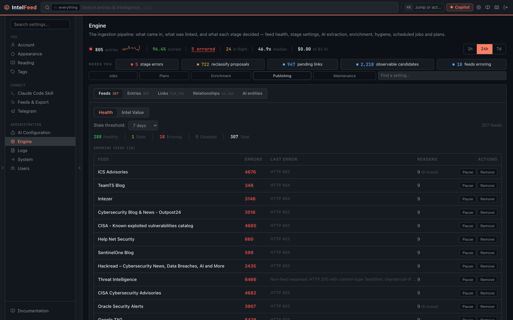

# Adding and managing feeds

Feeds are where everything else comes from. An instance with twelve good
sources is more useful than one with two hundred, so this is worth doing
deliberately rather than importing everything you've ever subscribed to.

Adding and editing feeds is admin-only on most instances.

*Feed health lives in the Engine console: what is healthy, what is stale, and what is erroring.*

## Adding one

**+ Add Feed** in the sidebar. The modal has five tabs.

### URL

The one you'll use most. Paste an RSS or Atom feed URL and IntelFeed works out
what it is — these are all recognised from the URL alone, no separate tab
needed:

| Paste this | You get |
|---|---|
| A YouTube channel | New videos, with transcripts where available |
| A subreddit | New posts |
| A Mastodon account | New posts |
| An NVD feed | CVEs as structured entries, not just article text |
| A podcast feed | Episodes, playable in the app |
| Anything else RSS/Atom | Articles |

If a site gives you a choice of feed URLs, prefer the full-content one over the
summary-only one. IntelFeed's extraction is only as good as the text it gets,
and a feed that ships two-sentence teasers produces thin entity linking.

### GitHub repo

Paste a repository URL to follow its releases or commits. Useful for tooling you
depend on, and for security advisories from projects in your stack.

### Web scraper

For a site with no feed at all. Point it at a page and IntelFeed extracts
articles from it. Expect this to be less reliable than a real feed — scrapers
break when sites redesign — so check it a week after adding it. The feed is
named after the page's own title on its first fetch; rename it under Identity
if that title is unhelpful.

### Bluesky

Follow an author, a custom feed, or a standing search query. The search option
is the interesting one: a standing query for your product name is a cheap
early-warning source.

### Telegram

Channels. This one needs a one-time admin bootstrap before the tab will work —
see [Telegram setup](#telegram-setup) below.

## Categories

Every feed belongs to a category, and categories are the folders in your
sidebar. This is the single most consequential decision in feed setup, because
categories are what you filter by for the rest of the instance's life.

The add-feed form asks for one whenever any exist. A feed created without one
through the API, the `create_feed` tool, or an OPML outline outside any folder
is filed in the category most feeds of its type already sit in; it stays
uncategorized only when no feed of that type has a category yet.

Group by **how you'd want to read them**, not by alphabet or by vendor:

- *Government advisories* — CISA, NCSC, national CERTs
- *Vendor research* — the big vendor blogs
- *CVE feeds* — NVD and friends
- *Ransomware* — leak sites, tracking blogs
- *Community* — Reddit, Mastodon, Bluesky, YouTube

The test: when something is on fire at 9am, which folder do you open? Build
those folders.

Create categories before you bulk-import, not after — re-filing a hundred feeds
by hand is tedious in a way that filing them once is not.

### Category settings and defaults

**Edit Category…** in a category's right-click menu (admin) changes settings on
every feed in it at once: fetch interval, retention, ratings, and what runs on
each new article. Two switches at the bottom say where the change goes:

- **Apply to the feeds here now** — every feed currently in the category.
- **Save the pipeline settings as this category's default** — a feed added to
  the category later (by hand, from OPML, or from a starter pack) starts with
  the analysis mode, AI analysis, tool entities, CVE/ATT&CK lookup and
  detection-rule settings saved here. Anything the category doesn't set uses
  the global default, and a value a feed is added with explicitly wins.

The defaults apply once, when a feed is created. Changing them, or moving an
existing feed into the category, doesn't change feeds that are already there —
that's what the first switch is for.

## Importing in bulk

**Settings → Feeds & Import** takes an OPML file, which is what every other
feed reader exports. Categories come across as folders.

After an import, go through and delete. An OPML export from a general reader
will carry a lot that has nothing to do with security, and every feed you keep
is volume you have to triage forever.

## Per-feed settings

Click a feed to edit it:

- **Category** — move it between folders.
- **Fetch interval** — how often it's polled, in minutes. Leave it alone unless
  you have a reason. A source that publishes twice a week doesn't need polling
  every five minutes, and a fast-moving one you're actually watching might
  deserve more.
- **Retention** — how long entries from this feed are kept before being cleaned
  up. Blank means the instance default. Set a short retention on high-volume,
  low-value sources; that's how you keep the database from being 80% noise.
- **Skip articles whose title contains** (admin, Source pane) — phrases, one
  per line, matched anywhere in the title and ignoring case. A matching article
  is dropped before it is saved, so it never reaches tagging, the AI or
  scoring. The pane shows how many of the feed's last 100 titles the list would
  have dropped, with examples, before you save. Use it for a source's recurring
  stubs: "ISC Stormcast For" on SANS ISC Diary, "Chromium CVE-" on MSRC.
  Articles already saved stay.
- **Mute** — stop it appearing in your reading views without deleting it and
  losing its history.
- **Source assessment** — your own note on how much you trust it.

## Keeping feeds healthy

Feeds die quietly. A site moves its feed URL, a scraper's target redesigns, a
token expires — and the feed just stops producing, which looks identical to "a
quiet week" until you go looking.

Two places to check:

- **The Feed Activity and Feed Health widgets** on the Dashboard. A feed whose bar went to zero
  and stayed there is the thing to investigate.
- **Settings → Engine → Feeds** (admin) shows fetch status, last success, error
  counts and reliability per feed. This is the definitive view when something's
  wrong.

Worth doing monthly. It takes five minutes and it's the difference between a
blind spot you know about and one you don't.

## Duplicates

The same story arrives from five sources, and IntelFeed deduplicates on content
rather than just URL, so syndicated copies collapse into one entry. The
*feed echo* signal in the [Priority Queue](priority-queue.md) uses the same
information in the other direction — an article everyone is running verbatim
gets pushed **down**, because volume of coverage isn't evidence of importance.

## Telegram setup

Telegram is the one source that can't be set up from the UI alone. Reading
channels needs a real Telegram **user** account — bots cannot read channels — so
an admin has to do a one-time bootstrap:

1. Create a Telegram API application at my.telegram.org and note the `api_id`
   and `api_hash`.
2. Put `TELEGRAM_API_ID` and `TELEGRAM_API_HASH` in the server's `.env` and
   restart the api and worker services.
3. Run the interactive login script on the host to write a persistent session
   file.
4. Back that session file up. Losing it means doing this again.

**Settings → Telegram** has the full walkthrough in-app, with the exact
commands.

Use a dedicated identity for this, not a personal account. It joins the channels
you track, and some of those are places you'd rather not be present under your
own name.

Once it's running, **Workbench → Telegram Mentions** is where channel chatter
surfaces.

## What happens after you add a feed

The feed is polled, new entries are stored and deduplicated, each one is scanned
for known entities and linked, and — if AI is configured — summarised and
extracted from. Then it lands in your entry list.

The first poll can take a few minutes. If a feed still shows nothing after an
hour, check Engine → Feeds for its error state.
