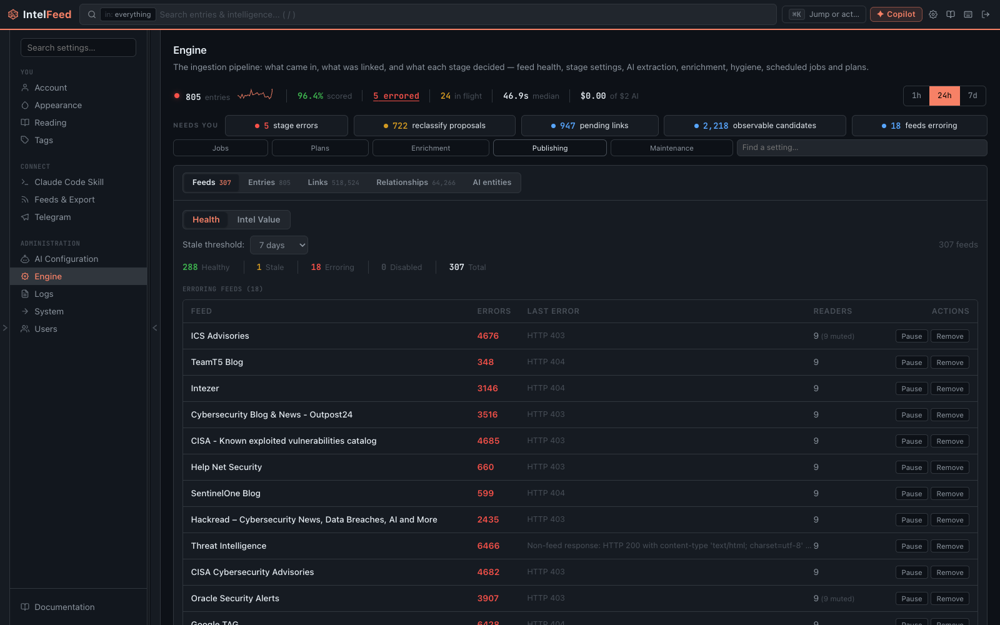

# Adding and managing feeds

Feeds are where every article comes from. This page covers adding, sorting
and tuning feeds, and spotting broken ones. Any signed-in user can add a feed;
admin-only settings are marked.

*Feed health in the Engine console: which feeds are healthy, stale or erroring.*

Start small. A dozen good sources are better than two hundred.

## Adding one

Click the **+** button (**Add feed**) in the sidebar. The **Add a source**
window opens on one box: paste any link and IntelFeed works out what it is.

| You paste | It finds | What you choose |
| --- | --- | --- |
| A site, such as `thedfirreport.com`, or a feed URL | The site's feeds | **Posts** or **Comments** (or the site's other feeds) when it has more than one |
| A YouTube channel, such as `https://www.youtube.com/@BlackHatOfficialYT` | The channel's feed | **Skip Shorts** (ticked unless you changed the default under **Settings → Feeds & Export**) |
| A GitHub repository | Whether it holds detection rules | **Releases**, **File changes** (all files, or the paths you type) and **Commits**; one feed for each you tick |
| A Bluesky profile, custom feed or search link | The account, feed or search | **Include reposts**, for an account |
| A Telegram channel, such as `https://t.me/<channel>` | The channel | Nothing; a warning appears if Telegram isn't set up on the server yet |
| A Mastodon hashtag page, such as `https://infosec.exchange/tags/threatintel` | The hashtag on that server | Nothing |
| A page with no feed | How many article links the page has | Nothing; **Follow this page** reads the page itself (the web scraper) |

The `/channel/`, `/c/` and `/user/` YouTube forms work too, and so does a link
to any of the channel's tabs. A link to a single video doesn't: open the
channel and copy that link instead.

For a GitHub repository, IntelFeed recognizes the detection rule repos it knows
(SigmaHQ, Elastic, Splunk, LOLBAS and more) and otherwise looks through the
repo's files for YARA, KQL, Sigma, Sentinel, Splunk and Elastic rules. If it
finds rules, **File changes** starts ticked with the rule folders filled in, and
changed rule files become detection rules. If it finds none, **Releases** starts
ticked (or **Commits**, for a repo that has never made a release).

Then pick the **Folder** (IntelFeed preselects the one feeds of the same kind
already live in, and **New folder…** makes one) and click **Subscribe**. Once
folders exist you have to pick one. **More options** sets how often to check
the source and its name; leave them and the type's default applies.

When the add creates one feed, its **Edit Feed** window opens next, so you can
change the rest of its settings right away (see
[Per-feed settings](#per-feed-settings)): rating, what runs on each article,
title filters, and the source settings such as a scraper's link selector or a
Telegram channel's linked threat actor. Adds that create several feeds just
close.

Prefer a site's full-text feed over a summary-only one. Scrapers break when a
site is redesigned, so check one again after a week.

Under the box, before you paste anything, are three other ways in:

- **Browse starter packs**: the curated packs that ship with IntelFeed. Each
  row shows how many of its feeds you already follow; open one, untick what
  you don't want, and click **Add**.
- **Import OPML**: a subscription list exported from another reader (Feedly,
  Inoreader, NewsBlur and others). Feeds you already follow are skipped.
- **Add without a link**: the sources with no link to paste.
  - **NVD CVEs**: new CVEs that mention any of the words you give, for
    example `fortinet, ivanti`.
  - **Bluesky search**: posts matching a search.
  - **Mastodon hashtag**: posts with a tag on one server, written as
    `#threatintel on infosec.exchange`.

### Telegram

An admin has to set Telegram up once on the server first. See
[Telegram setup](#telegram-setup) below. Until then, a pasted Telegram link
says so.

## Categories

Categories are the folders in your sidebar, and every feed sits in one. Group
feeds by how you want to read them, not by name or vendor. For example:

- *Government advisories*: CISA, NCSC, national CERTs.
- *Vendor research*: the big security vendor blogs.
- *CVE feeds*: NVD and similar.
- *Ransomware*: leak sites and tracking blogs.
- *Community*: Reddit, Mastodon, Bluesky, YouTube.

Group them by which folder you would open first during an incident.

Create categories before you import in bulk. A feed added without a category
goes into the one most feeds of its type already use.

Right-click a category (or long-press on a phone) for **Rename...**,
**Extract Intelligence**, and, for admins, **Edit Category...** and
**Delete Category**.

### Category settings and defaults

**Edit Category...** (admins only) changes settings for every feed in a
category: check interval, retention, source ratings, and what runs on each new
article. Two switches decide where the change goes:

- **Apply to the feeds here now**: changes every feed in the category today.
- **Save the pipeline settings as this category's default**: a feed added to
  this category later (by hand, from OPML, or from a starter pack) starts with
  the settings under "What runs on each new article". Interval, retention and
  ratings are never saved as defaults.

Defaults apply only when a feed is created. They don't change feeds already in
the category, or a feed moved into it. Use the first switch for that.

## Importing in bulk

**Import OPML**, under the paste box in the **Add a source** window, imports
an OPML file, the format other feed readers export. Folders become categories. Importing is admin-only,
unless per-user feed subscriptions are on (see
[Users and access](users-and-access.md)).

To save a copy of your feeds, use **Export OPML** under
**Settings → Feeds & Export** (admins only).

After an import, delete what isn't about security.

## Per-feed settings

Right-click a feed in the sidebar for **Edit Feed...**, **Mark All Read**,
**Refresh**, **Mute**, **Extract Intelligence**, **Translate Articles**,
**Move to...** and **Unsubscribe**.

**Edit Feed...** has six panes:

- **Overview**: what the feed has produced, and its last error.
- **Identity**: the **Display name**, the **Category**, and two switches.
  **Receive new articles** off pauses the feed. **Count toward unread** off
  mutes it (see below).
- **Source** (admins): the URL, feed type, **Check for new articles** (poll
  interval), **Keep articles for** (retention; anything extracted stays), and
  **Translate articles into English**. Set short retention on busy, low-value
  feeds.
- **Pipeline** (admins): what runs on each new article.
- **Assessment**: your rating of the source's reliability, timeliness and
  relevance, plus notes.
- **Readers** (admins): who reads the feed, and **Visible to visitors** for
  public read-only mode.

**Skip articles whose title contains** (admins, Source pane) drops articles
whose title contains a listed phrase (one per line, any case) before they are
saved, so they never reach tagging, AI or scoring. The pane shows how many of
the last 100 titles would have been dropped. Use it for repeating filler, such
as "ISC Stormcast For" on SANS ISC Diary. Articles already saved stay.

**Mute** hides a feed's articles from your main list and unread count. You can
still open the feed. Its articles are still tagged, analyzed by AI and scored.
A muted feed's Overview shows its AI use over the last 30 days, and an admin can
switch its AI off there in one click. Muted feeds are listed in a **Muted**
group in the sidebar.

## Keeping feeds healthy

A feed that stops is easy to miss, because it looks like a quiet week. Check
once a month in:

- The **Feed Activity** and **Feed Health** widgets on the Dashboard. A bar that
  drops to zero and stays there needs a look.
- **Settings → Engine**, **Feeds** view (admins). It lists dead, empty,
  erroring, stale and disabled feeds, with each feed's errors and value.

## Duplicates

IntelFeed compares the title and the start of the text, so copies of one story
become one entry. The Priority Queue ranks
an article that many feeds copy word for word **lower**, because more copies
doesn't mean more important. See [Priority Queue and watching](priority-queue.md).

## Telegram setup

Telegram is the one source an admin sets up on the server first. Reading
channels needs a real Telegram user account, because bots can't read channels.

1. Create a Telegram API application at my.telegram.org and note the
   `api_id` and `api_hash`.
2. Put `TELEGRAM_API_ID` and `TELEGRAM_API_HASH` in the server's `.env` file
   and restart the services.
3. Run the interactive login script on the server. It saves a session file.
4. Back up that session file. If you lose it, you have to log in again.

**Settings → Telegram** (admins) walks through each step with the exact
commands.

Use a separate Telegram account, not a personal one. It joins every channel
you track.

To find channels, open **Workbench → Telegram Mentions**: the channels your
articles link to, and where each was mentioned.

## Adding content by hand

The upload button next to **+** in the sidebar (**Ingest**) adds content that
isn't in a feed. It has three tabs:

- **URLs**: one link per line. A GitHub repository link adds one item per file.
- **Files**: drop many files at once. A `.zip` file is unpacked.
- **Paste**: paste a report, an advisory or a chat log.

Tick **Indicator list** when each line is one indicator (IP, domain, hash or
URL). Each item becomes an entry under **Manual Uploads** and is processed like
any article. The original file can be downloaded from the entry.

## What happens after you add a feed

IntelFeed saves new articles, merges duplicates, and links the entities each
mentions. If AI is set up, it also summarizes each article.

The first check can take a few minutes. If a feed still shows nothing after an
hour, look for its error in the feed's **Overview** pane or in
**Settings → Engine**, **Feeds** view.

Next: [Reading and triage](reading-and-triage.md)
