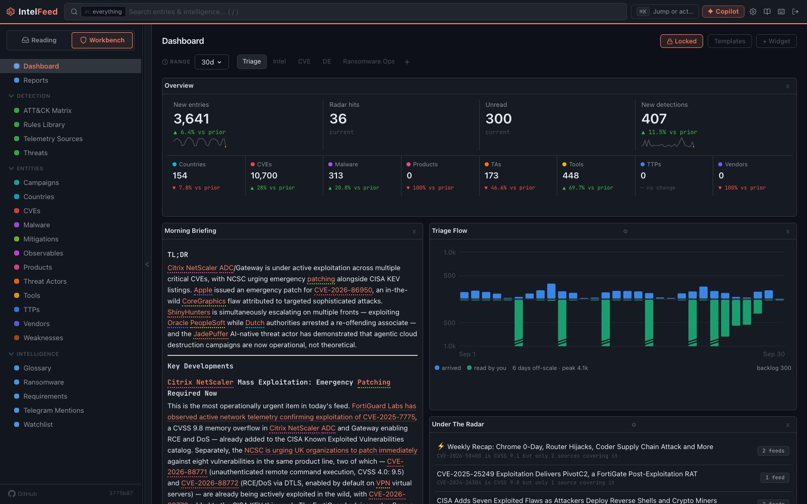

# Getting started

What to do in your first hour, in order: sign in, take the setup tour, add a
few feeds, and change the handful of settings that make daily reading
comfortable.

*The dashboard once feeds have been running for a while.*

## Your account

The first account created on a new instance becomes the admin. After that,
signing up usually needs an invite. If you were given a username and password,
use them. If you were sent an invite link, it opens the register page with the
code filled in.

There are two roles. Everyone can read everything, add feeds, write notes,
build campaigns and reports, save searches and write detection rules. Admins
can also manage and delete feeds, and they control AI configuration, users,
the Engine and system settings. When this guide says "admin only", that's why.
Running an instance for a team is covered in [Users and access](users-and-access.md).

## The onboarding tour

The first time you sign in, a tour opens. It starts with a **Welcome** step and
then has three chapters. You can skip any step. Closing the tour
(**Close — resumes here**) saves your place. To come back to it, go to
**Settings → Account → Getting started** and choose **Resume the tour** (back
to the step you left) or **Replay from the start**.

**Set up** (admins only). A step is skipped when it's already done.

1. **Reference data**: checks that the country, ATT&CK, CWE and vendor/product
   lists are loaded, and shows the command to run if they aren't. Without them,
   articles still come in but most entity types never get linked. This is the
   most common reason IntelFeed "looks broken".
2. **Add feeds**: starter packs, an OPML file, or a single URL.
3. **AI provider**: Ollama, Claude, an OpenAI-compatible endpoint, or
   **Skip — run without AI** (the step lists what you lose). Connecting a
   provider tests it and then points the AI tasks at it, because a provider
   that no task uses does nothing. The step shows how many tasks now use it and
   which model.
4. **Services & team**: optional extra services, invites and roles.
5. **Verify it works**: waits for real feed fetches and shows feeds fetched,
   articles ingested and entities linked.

**Learn the app** (everyone): the reading loop, the Priority Queue, entities
and pivoting, search, the workbench, and rules and intel products.

**Make it yours** (everyone): appearance, keyboard shortcuts, and where to find
help.

If someone else already set the instance up, you skip the Set up chapter and
go straight to the tour of the app. To drive IntelFeed from Claude Code, see
**Settings → Claude Code Skill**.

## Adding feeds

Click the **+** button (**Add feed**) in the sidebar. Paste an RSS or Atom
feed URL, or a website address, and IntelFeed finds the feed. Other tabs cover
GitHub repositories, web scraping, Bluesky, Telegram and OPML files.

Start with a few good sources. You don't need a hundred feeds on day one, and
pointing IntelFeed at everything buries the articles that matter.

Put each feed in a category. Categories are the folders you'll filter by from
then on, so group feeds by what you'd want to read together, for example
"Vendor research", "CVE feeds" or "Government advisories".

[Adding and managing feeds](feeds.md) covers the rest: every source type, bulk
import, per-feed settings, spotting a dead feed, and the one-time setup
Telegram needs.

## Settings worth setting on day one

**Settings → Reading** (everyone)

- **Reader Typography**: font size, line spacing and content width. You'll
  spend hours in the reader, so make it comfortable.
- **Default view** and **Default sort order**: all entries or unread only, and
  newest or oldest first.
- **Compact view** and **Show entry previews**: how much of each article the
  list shows.
- **Mark read on scroll**: on if you skim, off if you triage one article at a
  time.

**Settings → Appearance** (everyone): pick a light or dark theme. Changes apply
at once.

**Settings → Engine** (admins): in the **Feeds** view, **Image Proxy Enabled**
loads article images through your server. Article sites never see your
analysts' IP addresses, and images load faster. The catch is that a saved copy
doesn't change if the original image does.

**Settings → AI Configuration** (admins): on the **Providers** tab, check the
provider you set up during the tour.

**Settings → Engine → Enrichment** (admins): turn on the enrichment sources
you want. NVD, EPSS and CISA KEV make a CVE page worth opening. They add the
severity score, how likely the flaw is to be exploited, and whether it's known
to be exploited. See [Entities and profiles](entities.md).

## What happens next

Feeds are checked on a schedule. As articles arrive, IntelFeed finds known
entities in each one and links them. If AI is set up, it also summarises each
article and pulls out more detail.

Give it a few days before you judge the intelligence side. Entity pages grow
over time: they're thin on day one and useful by the end of the month.

Next: [Adding and managing feeds](feeds.md)
