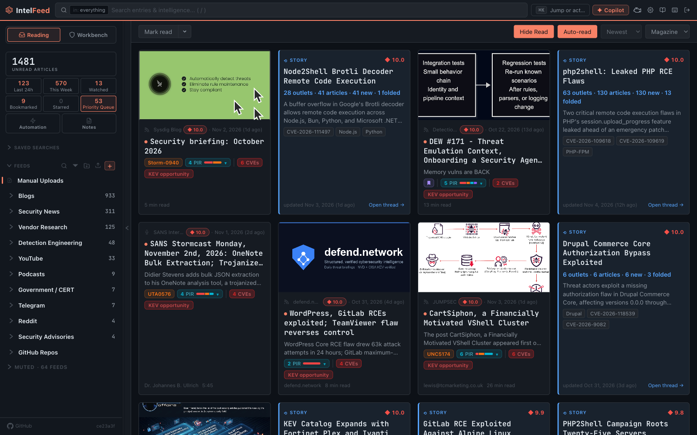

# Priority Queue and watching

The Priority Queue shows your unread articles ranked by how likely they are to
matter. This page explains what the ranking looks at and how to steer it, so
you can get through a big backlog in a short time.

Open it with **Priority Queue** in the sidebar. To use the same ranking inside
any search, add `sort:radar` to the query.

## What it looks like

*Each card is one story, not one article. Repeat coverage is folded in and counted.*

It works like the normal article list and reader, with the same keys and
actions, but it is sorted by priority score instead of date. Two things are
different.

**The "Why this ranked" card.** Each article shows its score and the signals
that raised it, with what each one added. You can always see why something
ranked where it did.

**Story rows.** When several outlets cover the same story, the queue shows it
once, as one row you can open. The articles inside it are left out of the
list. A story ranks by the score of its best unread article, and sits in the
same highest-first list as single articles. Once you've read a story, it
leaves the queue.

What a story row opens into is covered in [Story threads](story-threads.md).

## What the ranking looks at

The ranking uses *signals*: specific, checkable facts about an article. They
come in five families.

**Novelty**: is this new?
- *novel entity*: the first, or nearly first, mention of an actor, malware or
  tool
- *entity resurgence*: something coming back after a long quiet spell
- *new pairing*: two entities named together for the first time
- *scoop*: this source broke the story

**Coverage**: who else is reporting it?
- *source convergence*: separate outlets reporting the same story
- *under-reported*: real substance, but little coverage
- *feed echo*: the opposite, many outlets reprinting one piece

**Severity**: how bad is it?
- *KEV added*: a CVE was added to CISA's Known Exploited Vulnerabilities list
- *EPSS jump* / *EPSS high*: the predicted chance of attack (EPSS) is rising,
  or already high
- *weaponised PoC*: working exploit code exists
- *critical CVSS*: the CVE has a critical severity score

**Interest**: does this match what you care about?
- *PIR match*: it matches one of your intelligence requirements (PIRs, the
  standing questions you need answered)
- *correlation event*: it connects to something already being tracked

**Content**: is there something to act on?
- *detection content*: the article contains detection rules or logic
- *research depth*: real analysis, not a short news item

Each signal also works as a search filter, such as `signal:under_reported` or
`signal:kev_added`, so you can turn any signal into a saved search.

Rare signals count for more. A signal that fires on half the articles adds
almost nothing to the score.

## Steering it

You can steer the ranking in three ways.

**Watch and mute.** Use **Watch** on any entity profile, or **Mute entity** in
its **⋯** menu (see [Entities and profiles](entities.md#watching-and-muting)).
Watched entities raise their articles, and can bring an article into the queue
even when its score is below the usual cut-off. Muted entities drop out of
your queue, but still show in search and your feeds. Both are personal.

This is your biggest lever. Watch your vendors, your products, the actors that
target your sector, and the sector itself. Watching **Healthcare**, for
example, raises every article the analysis judged to be about attacks on
healthcare.

**Votes.** The "Why this ranked" card has **▲** (useful) and **▼** (noise)
buttons. All
users' votes together adjust the shared ranking by at most 10% either way, so a
few votes can't swing what everyone sees.

If an admin has turned on **Personalised Radar**, a **Your Radar** card
appears under **Settings → Reading**. Switch it on and your own votes set a
personal weight for each signal family, refitted nightly. These weights change
the order of article lists sorted by `sort:radar`. They don't reorder the
Priority Queue, which always runs in the order of the score each row shows.
They can bring extra articles into it, though. The card shows each family's
weight and the votes behind it. You can pause it to see the shared ranking, or
clear the learned weights and start over.

**Intelligence requirements.** *PIR match* is the one signal you define. Write
your requirements under **Intelligence → Requirements** in the Workbench
sidebar: the sectors, regions, technologies and actors you are responsible
for. Articles that match them rank higher. If you do one piece of setup beyond
watching entities, do this.

Keep requirements narrow. Because rare signals count for more, a requirement
so broad that most articles match it stops helping. A few narrow requirements
work better than many broad ones.

## Working it

1. Open the Priority Queue and work from the top. You don't need to read the
   whole list.
2. Read the "Why this ranked" card before the article. It often tells you
   enough on its own, for example "EPSS jumped from 0.04 to 0.71".
3. Star what needs real work. Mark the rest read.
4. Vote **▼** on anything that wasted your time, so you see less like it.
5. When the items stop being interesting, stop. That is the point of the
   queue; there's no prize for reaching the bottom.

Give your votes a couple of weeks to have an effect before you decide the
ranking is wrong for you.

Next: [Story threads](story-threads.md)
