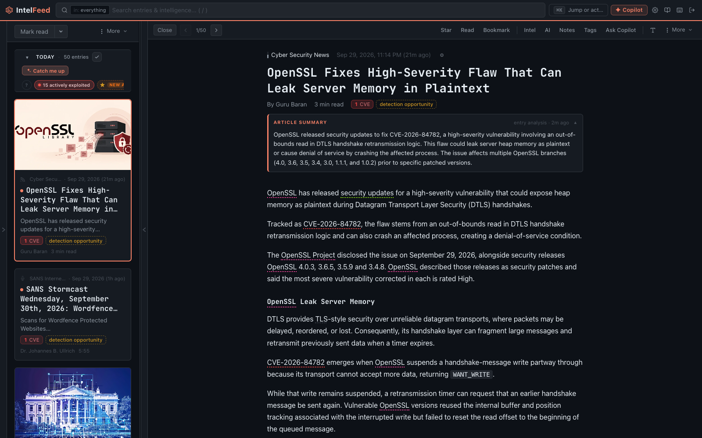

# Reading and triage

The reading side of the app: three panes, a keyboard, and a queue you need to
get to the bottom of.



*An article open in the reader. Entities mentioned in the body are already linked, and the summary above the text is generated at ingest.*

## The layout

```
┌───────────────┬─────────────────┬──────────────────────┐
│  SIDEBAR      │  ENTRY LIST     │  READER              │
│               │                 │                      │
│  Reading ⇄    │  One row per    │  The article, with   │
│  Workbench    │  article        │  entities linked     │
│               │                 │                      │
│  Quick views  │  Day dividers   │  Notes / intel / AI  │
│  Categories   │  and summaries  │  panels on the side  │
│  Feeds        │                 │                      │
│  Saved        │                 │                      │
│  searches     │                 │                      │
└───────────────┴─────────────────┴──────────────────────┘
```

Both sidebars are resizable and collapsible. On a phone the panes stack: the
sidebar slides in from the left, and tapping an article opens the reader
full-screen.

## The sidebar

At the top is the **Reading / Workbench** switch. It changes what the rest of
the sidebar lists, and it follows you: switching to Workbench navigates there.

In Reading mode you get:

- **Quick views** — Last 24h, This Week, Watched, Bookmarked, Starred.
- **Categories and feeds** — click one to filter the list to it. The badge is
  the unread count.
- **Saved searches** — see [Searching](searching.md).

## The entry list

One row per article: title, source, date, and a preview. An unread article
carries a dot.

**Day dividers** break the list up by publication day, and each divider carries
chips for that day's most-mentioned actors, malware and exploited CVEs — a
quick read on what a day was about before you open anything.

Each day can also carry an AI triage summary. These are **shared across the
instance**: once anyone generates the summary for a day, everyone sees it, and
regenerating it spends AI tokens on everyone's behalf. Entity names inside a
summary are hoverable — the popover tells you who an actor is without leaving
the list.

**Selection.** Tick the checkboxes to select several articles, then use the
toolbar to star, tag, mark read, or add them all to a campaign at once.

## The reader

The article itself, plus:

- **Linked entities** — actor, malware, CVE, technique, vendor, product,
  country and tool names are turned into links in the body text. Clicking one
  opens its profile. This is the main way to move around the app.
- **Panels** — `n` for notes, `w` for the intel panel (everything linked to
  this article, in a list), `a` for the AI panel.
- **Toolbar** — star, bookmark, tag, open the original, export as markdown, add
  to a campaign, read aloud.

**Find in article** — `Ctrl+F` / `Cmd+F` searches inside the open article.
Useful when you're scanning a long report for one hash or one technique.

**Read aloud** — the speaker icon synthesises the article server-side and plays
it through the shared audio player; the audio is cached, so the second listen is
instant. If synthesis fails it falls back to the browser's own voice.

### If something is linked wrongly

Entity linking is dictionary-based and occasionally wrong — "apt" in a sentence
about package managers, a product name that's also an ordinary English word.
Use the **Wrong?** control on the link. It asks what exactly was wrong, with
four answers of increasing scope:

- just this article,
- this alias anywhere (the name it matched on is bad),
- this entity anywhere,
- this word, never link it again.

Pick the narrowest one that's true. These are real corrections — they change
what gets linked from then on — so "this word, never again" on a name that's
usually right will cost you links you wanted.

## Keyboard

| Key | Action |
|---|---|
| `j` / `↓` | Next entry |
| `k` / `↑` | Previous entry |
| `o` / `Enter` | Open the original article |
| `s` | Star / unstar |
| `b` | Bookmark / unbookmark |
| `m` | Toggle read / unread |
| `Shift+M` | Mark everything above as read |
| `t` | Tag this entry |
| `e` | Export as markdown |
| `n` | Notes panel |
| `w` | Intel panel |
| `a` | AI panel |
| `/` | Search |
| `Ctrl+K` / `⌘K` | Command palette |
| `Escape` | Close whatever is open |
| `?` | This list, in the app |

`Shift+M` is the one to learn. Skim down with `j`, stop at the first article you
actually care about, `Shift+M`, and everything you skipped past is read.

## Starred vs bookmarked vs tagged

Three flags, and people muddle them. A working split:

- **Star** — "I'm coming back to this today." A short-lived queue.
- **Bookmark** — "This is a reference I'll want in a year."
- **Tag** — the durable, searchable one. `to-rule`, `customer-impacting`,
  `false-positive`. Tags are what you build saved searches on.

Tags are instance-wide and get messy; **Settings → Tags** lets you rename,
recolour and merge them, which is how you fix `to-rule` vs `to_rule`.

## Clearing a big inbox

Two hundred unread and twenty minutes:

1. Start in the **Priority Queue**, not the full list — it's the same articles
   ranked by what's likely to matter. See
   [Priority Queue and watching](priority-queue.md).
2. Work the top of that ranking with `j` and the Why card. Star anything worth a
   real look.
3. Switch to the full list, set it to **Last 24h**, and skim the day summaries
   and divider chips rather than the articles.
4. `Shift+M` on the last row to clear the rest.
5. Go back to **Starred** and do the actual work there.

The point of the pass is to end with five or ten articles you chose, not to read
two hundred.

## On a phone

The three panes stack. Swipe right from the left edge to bring the sidebar in,
swipe it left to put it away; tapping an article opens the reader full-screen.
Entry actions are in the reader toolbar and the row's own controls rather than
swipe gestures.

A commute is good for sorting, not for deciding: star what deserves a proper
look, mark the rest read, and pick the stars up on a real screen later.
