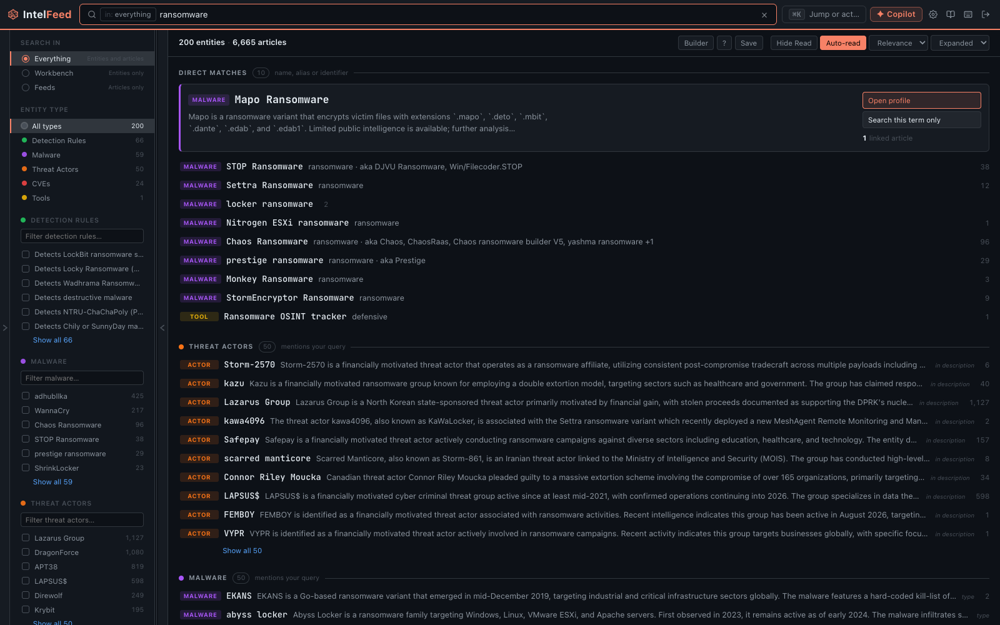

# Searching

One box, one results page. The field in the header is the only search input in
the app, on every route and every screen size. Typing in it takes you to
`/search`, which is the only place results are drawn.



*One query returns both articles and entities, with facets to narrow by type.*

## The basics

Open it with `/`. Type what you're looking for:

- `ransomware` — articles mentioning it
- `APT29` — articles about APT29, *and* the APT29 entity itself
- `CVE-2026-1234` — the CVE and everything linked to it
- `LockBit builder` — articles containing both words

## Scope

The box carries a scope chip. **Tab** cycles it:

| Scope | Results |
|---|---|
| Everything | Entities and articles |
| Workbench | Entities only |
| Feeds | Articles only |

It only decides what the results page shows — it never navigates you somewhere
else. It starts on whatever suits the page you searched from and then stays
where you put it.

## Direct matches vs mentions

Results come back in two halves, and the distinction is the most useful thing
about the results page.

**Direct matches** are things whose *name* you typed. Searching `lockbit`
surfaces the LockBit group itself.

**Mentions** are things that merely talk about it — thirty other actor profiles
that cite LockBit, sixteen YARA rules that detect it, the articles that name it.

Direct matches come first with the top one expanded; mentions are grouped by
type below. The filter rail can show you one or the other if you only want one.

## The filter rail

The rail on the left narrows results: scope, entity type with counts, matched-on,
and for articles a published window, read state, feed, content type, tags, media
and language.

Everything you tick is **written back into the search box as a filter**. Tick
"Last 7 days" and "Unread" and the box now reads `date:>=… is:unread`. That's
deliberate: you can see exactly what the rail did, hand-edit it, and save the
result. Clicking around the rail is a decent way to learn the query syntax.

On a phone the rail is a slide-over behind the **Filters** button.

## Field filters

Free text plus field restrictions. A few that earn their keep:

```
feed:nvd cve.severity:critical
# NVD articles carrying a critical CVE

threat_actor:APT29 date:>2026-01-01
# APT29 articles from this year

cve.kev:true cve.epss:>0.5
# Known-exploited AND statistically likely to be attacked

signal:under_reported sort:radar
# What the engine thinks is under-covered, in its own ranking

rule.data_source:sysmon rule.tactic:persistence
# Persistence detections that run on telemetry you already collect

category:"Vendor Blogs" is:unread
# Unread articles from one folder of feeds

is:starred NOT type:youtube
# Your starred entries, minus video
```

There are 18 article fields and 94 intelligence fields. The box autocompletes
them as you type and the **?** button opens the full reference card in-app.
[Query language](../query-language.md) is the complete reference.

`sort:radar` is worth remembering: it orders by the signal engine's priority
score — the same ranking the [Priority Queue](priority-queue.md) uses.

## Your notes are searchable

Notes come back as their own result group, alongside actors and CVEs — the note
you left on an article, the one on a threat actor's profile, and the standalone
one in the Notes panel.

The row shows the sentence that *matched*, not the note's first line, because a
note is prose and its opening rarely says why it turned up. A note on an entity
with no title is named for its subject: "Note on CVE-2026-20262".

```
note:fortibleed          # title or body
note.tag:followup        # by tag
note.about:cve           # notes you left on CVEs
note.about:entry         # notes on articles
note.about:standalone    # notes attached to nothing
note.pinned:true         # just the pinned ones
note.type:analysis       # entity notes of one type
```

`note.about:entry` pulls the articles through too, so you get the notes and what
you wrote them on.

**Notes are shared across the instance.** Search shows any note anyone wrote.
Only the author or an admin can edit or delete one, but everyone can read it.
Write accordingly.

## The command palette

`Ctrl+K` / `⌘K`. Type a prefix to jump rather than search:

- `feed:` — switch feeds
- `rule:` — a rule in your library
- `campaign:` — a campaign
- `search:` — a saved search
- `page:` — any page in the app

## The rule library has its own search

**Workbench → Rules Library** searches separately, because there a rule is the
subject rather than one result type among many. It's a faceted list: type, and
the rail's counts narrow with you across format, severity, tactic, technique,
log source, repo, author, license, tags, and the actors and malware the rule's
source article mentioned. Ticking two formats *widens* the list rather than
emptying it.

Use `rule:` filters in the main box when you want rules alongside other
intelligence; use the library when rules are the work.

## Saved searches

Run a query, click **Save**, name it, and it pins to the sidebar.

```
tag:to-rule is:unread                    # flagged for rule work, not yet read
category:"Vendor Research" is:unread     # one folder, unread only
type:youtube OR type:podcast             # everything to watch or listen to
signal:under_reported                    # what the engine thinks is under-covered
```

**The number beside a saved search can lie; the search itself does not.**
Opening one runs the real query and returns exactly what the search bar would.
The count next to it is computed by a background job that skips the intelligence
half, so any search built on an entity filter shows a number you can't trust —
`country:"United States"` reads 0 next to a search that opens 5,896 articles.

Counts are reliable for `tag:`, `feed:`, `category:`, `type:`, `date:`, `is:`
and plain text. `signal:`, `sector:` and `url:` read low past about 500 matches.
