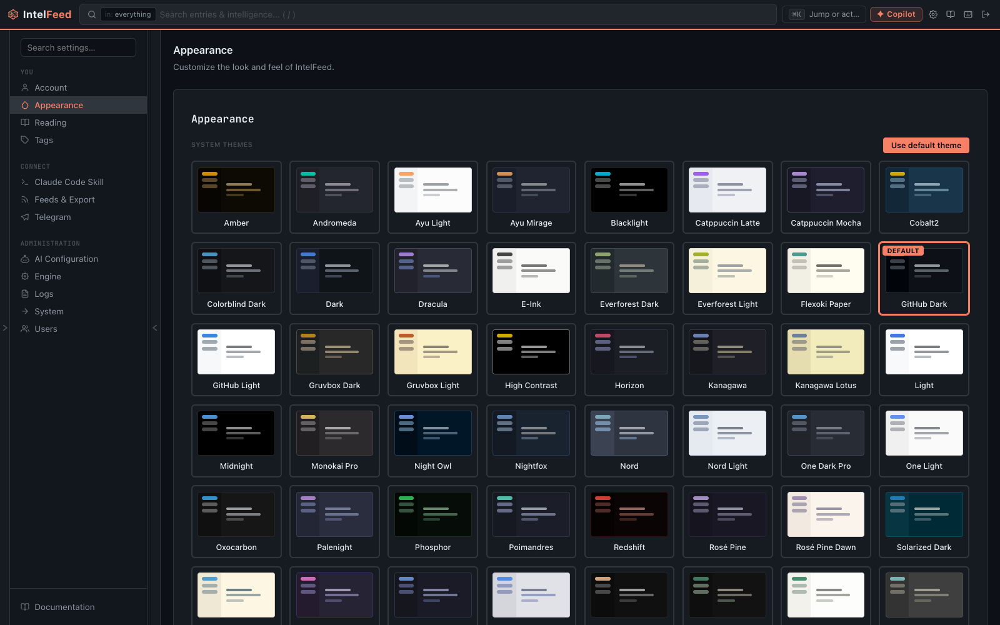

# Settings and personalising

Settings opens with its own nav rail; the app sidebar folds away beside it.
What you see depends on your role — non-admins get Account, Appearance, My AI,
Reading, Tags and Claude Code Skill; admins get everything.

*Themes are switchable at runtime; the whole palette is CSS variables.*

## Account

Profile and password, plus **Getting started** — the onboarding tour. If you
closed the tour partway through, **Resume the tour** reopens it on the step you
left; **Replay from the start** runs the whole thing again. See
[Getting started](getting-started.md).

## Appearance

The theme gallery — several dozen built-in light and dark themes, plus any
custom ones your instance has. Changes apply instantly, so click through them
rather than reading the names.

If you're going to be in the app all day, this is worth two minutes. Contrast
and density matter more than they sound when the job is scanning lists.

## My AI

Your own AI key, if your admin allows personal keys. Add a key of a type your
admin allows (Claude API, OpenAI-compatible, Ollama), pick which prompts run on it (or set it
as your default), and see this month's spend against your cap. Each key shows
when it was last tested and whether that test passed. Prompts you run
yourself — the copilot, rule drafts, summaries, reports — use your key; the
pipeline, automation rules and share links never do. If the policy is off, the
page says so. Covered in [Automation and AI](automation-and-ai.md#your-own-key).

## Reading

Where the reading experience is tuned.

**Display** — default view (all entries or unread only), entries per page,
default sort order, date format.

**Behavior**

- *Open links in new tab* — whether article links leave the app.
- *Mark read on scroll* — on if you skim, off if you triage deliberately. This
  one changes how the whole app feels; try both.
- *Show entry previews* — the snippet under each title.
- *Compact view* — more rows per screen, less of each.

**External links** — a confirmation before you follow a link that leaves
IntelFeed. Links to other pages inside IntelFeed are never affected. The dialog
shows the destination host in large type and the full URL in a block you can
copy (or copy defanged). It gives a red banner when the link's text names one
site but the link goes somewhere unrelated, and a quieter amber note when the
destination is related to the named site (for example an indicator domain
linked to a VirusTotal page about it, or a parent domain and its subdomain).
A shortener, a raw IP, an internationalised domain, an HTTPS-to-HTTP downgrade
or a `user@host` URL also get a note; they are worth a second look in a
phishing write-up.

The scope is a choice: *links in articles and summaries* (the default —
feed-supplied text and generated summaries are untrusted), *all external
links*, or *off*.

Every outside link asks first, including links to the site of a feed you
subscribe to. The only exceptions are MITRE, NIST (NVD), CVE.org and CISA
(and their subdomains), plus hosts you add by ticking "Don't ask again" in the
dialog; those hosts are listed here and can be removed. Trust is per exact
host, so trusting `example.com` does not trust `blog.example.com`. Even a
trusted host still asks when the link's text names an unrelated site (red),
when the URL has a `user@host` section, or when it downgrades from HTTPS to
HTTP. Middle-click and ⌘/Ctrl-click are held too; the browser's own
right-click menu is not.

**Reader typography** — font size, line height, column width for the article
pane.

**Read aloud** — the voice and playback settings for server-side text-to-speech.

**Your Radar** — only present when an admin has enabled Personalised Radar. It
shows each signal family's learned weight, the votes behind it, and both ways
out: switch back to the house ranking, or discard the fitted weights.

The honest advice: leave sort on newest-first and default view on unread, and
spend your tuning effort on the [Priority Queue](priority-queue.md) instead.
Ordering your whole inbox differently is a much weaker lever than ranking it.

## Tags

The tag manager: rename, recolour, merge and delete tags across the instance,
with usage counts.

Merge is the one that earns its place. Tags are free-text and instance-wide, so
within a month you will have `to-rule`, `to_rule` and `torule`. Merging folds
them together without losing anything.

Tags are the durable, searchable flag — see the star/bookmark/tag split in
[Reading and triage](reading-and-triage.md).

## Claude Code Skill

Setup instructions for pointing Claude Code at your instance, so you can drive
IntelFeed from a terminal rather than the UI. The page gives you the install
steps and the environment variables.

There are two skills: the full one, and a read-only variant that exposes only
query and search tools. Use the read-only one unless you specifically want an
agent that can write.

## Admin sections

**AI Configuration** — four tabs. *Providers* (which model runs which task, and
keys), *Prompts* (the prompt behind every AI task, editable), *Cost* (tokens and
spend per provider, task and person), *User keys* (whether people may bring
their own keys, which types, the caps, which prompts, and everyone's keys).
Covered in [Automation and AI](automation-and-ai.md).

**Engine** — the ingestion pipeline console: feed health, stage settings,
autolinking, AI extraction, enrichment, scoring, scheduled jobs and pipeline
plans. See [the engine reference](../engine.md). Old `/workbench/engine` links
redirect here.

**Feeds & Export** — OPML import/export and feed management, including per-user
subscriptions if your instance has them on. See [Feeds](feeds.md).

**Telegram** — the one-time bootstrap walkthrough.

**System** — monitoring (Sentry), database backups and how long they're kept,
and maintenance buttons such as rebuilding the search index. Settings are stored
in the database, so they change without a redeploy, and most of them live with
the thing they control: pipeline thresholds, API keys, rate limits and the image
proxy in the Engine console above, registration and invites under Users.

**Users** — accounts and roles. See [Users and access](users-and-access.md).

**Logs** — automation runs, AI task logs, per-task costs and errors. The first
place to look when an automation seems to have stopped.

## What isn't in Settings

One thing people hunt for here and don't find: **the glossary**, which lives at
**Workbench → Glossary**.

Webhook URLs aren't a settings section either; they're configured on the
notification action inside each automation rule.
