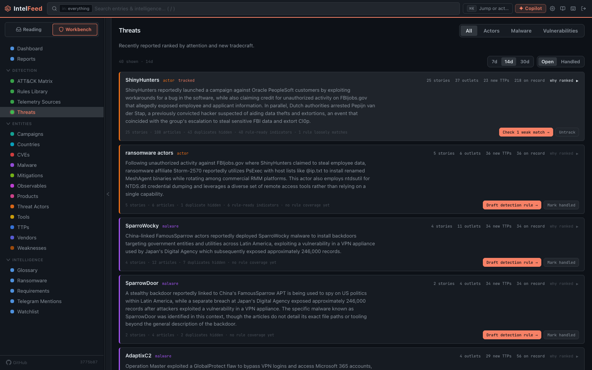

# The Threats board

The Threats board, at **Workbench → Threats**, helps you decide what to write
a detection rule for this week. It ranks recently reported threats, gives each
row one suggested job, and shows how it worked out the rank. After this page
you can read a row, see why it ranks where it does, and know what its button
does.

## The controls

- **Tabs: All, Actors, Malware, Vulnerabilities.** The first three show the
  same board filtered by type. **Vulnerabilities** is a separate view (see
  [below](#the-vulnerabilities-tab)). The tab is saved in the page address, so
  you can bookmark it.
- **Window: 7d, 14d, 30d.** How far back "recently reported" goes. Everything
  on the board, including the rank, is worked out over this window.
- **Open / Handled.** The board starts on **Open**. **Mark handled** on a row
  moves it to Handled. If new tradecraft (new attacker techniques) is
  reported, the row comes back to Open by itself. **Reopen** moves a handled
  row back.

## Reading a row

A row shows four things: the threat, the story, a line of facts, and a button.

**The story** is a short summary of what was reported. If there is a nightly
AI brief for the threat, you see that, written only from articles in the
window. Otherwise you see the lead headline, its outlet, and whether that
outlet reported it first.

**The facts line** looks like `3 stories · 17 articles · 6 duplicates hidden ·
4 rule-ready indicators · 2 rules name it · +1 weak`. The board counts
*stories*, not outlets, so many outlets repeating one report count as one
story. See [Story threads](story-threads.md).

**The button** names the job to do, based on what your rule library already
has:

| Button | What it means |
| --- | --- |
| **Draft detection rule →** | No rule covers this yet. Write one from the reported tradecraft |
| **Extend *N* rules →** | Rules already name this threat. Add the newly reported techniques |
| **Check *N* weak matches →** | Only loosely matching rules exist. Compare them with what was reported |
| **Audit *N* known TTPs →** | Coverage looks current. Check it against all known techniques |
| **Adopt *N* ready rules →** | Matching rules can run on the logs you collect today |
| **Rules need telemetry →** | Rules exist, but they need logs you don't collect yet |
| **Read the story →** | A story that doesn't name an actor, malware or CVE yet. Read it and identify it |
| **Send to merge** | This row is a duplicate of another threat |

The button opens the threat's profile (for a CVE, its **Detection** tab),
where the coverage view and the [rule tools](detection-rules.md) are. A story
row opens its thread instead. *Adopt* and *Rules need telemetry* only work if
your [Telemetry Sources](workbench.md) list is filled in. Without it, the
board can't tell which rules can run.

## The drawer

Click a row to open it. It has three columns:

- **Articles** (or **Coverage**, when stories were folded together): the
  articles behind the row, with outlet, date, and how many techniques each
  one names. Each opens in the reader or at the source.
- **New this window**: techniques not known for this threat before the window
  began. This is what *new tradecraft* means here.
- **Why this rank**: the score and what it's made of: stories, outlets, new
  tradecraft, rule-ready indicators, and your rules split into rules that
  *name* the threat and weak matches.

A story row shows **What's extractable** in place of the middle column.

When a threat has a story behind it, the drawer may also show **Precedent**:
the most similar past story, with a percentage match. Use it to ask "have we
seen this before?"

The board shows **no coverage percentage** on purpose. Counting how many of a
group's techniques have some rule tagged with them comes out near 90% for
almost every actor, which tells you nothing. The rule list is there to open
and check.

A row marked **"Held out of the ranking — a category, not a threat"** is a
general word the extractor mistook for an entity. An admin can clean it up in
the Engine console. It isn't a threat to chase.

## Stories with no name yet

Some stories don't name an actor, malware or CVE. If one still has something
you could act on (a technique, an observable, or a product you follow), it
gets a row tagged as a story. Its button is **Read the story →**, which opens
the thread in a reader beside the board. The same thread is in the
[Priority Queue](priority-queue.md). It has no rule list, because there's
nothing to match rules against until something names it.

## The Vulnerabilities tab

This tab ranks CVEs by how much they are being exploited, not by how much
they're reported. Being in CISA's KEV list (known exploited) raises a CVE the
most, then a high EPSS score (the predicted chance of attack), then a known
exploit. The drawer shows the exact boost for each row. A CVE in a product you
use is raised further.

"A product you use" comes from your **stack**:

- **Manage stack**, at the top right of this tab, lets you follow vendors and
  products. Until you follow some, the tab says so and ranks every CVE.
- Once you have a stack, four tiles show: how many CVEs are **new this week
  in vendors you follow**, how many are **actively exploited** (in CISA KEV or
  with a weaponized exploit), how many have **no rule** in your library, and
  which CVE is **trending now** by mentions.
- **The long tail — your stack, exhaustive**, below the ranked list, lists
  every CVE for your stack, not just the top ones.

## Where to go next

- To group a threat into an investigation, see
  [Campaigns and reports](campaigns-and-reports.md).
- For the same kind of ranking applied to articles, see
  [Priority Queue and watching](priority-queue.md).

Next: [Writing detection rules](detection-rules.md)
