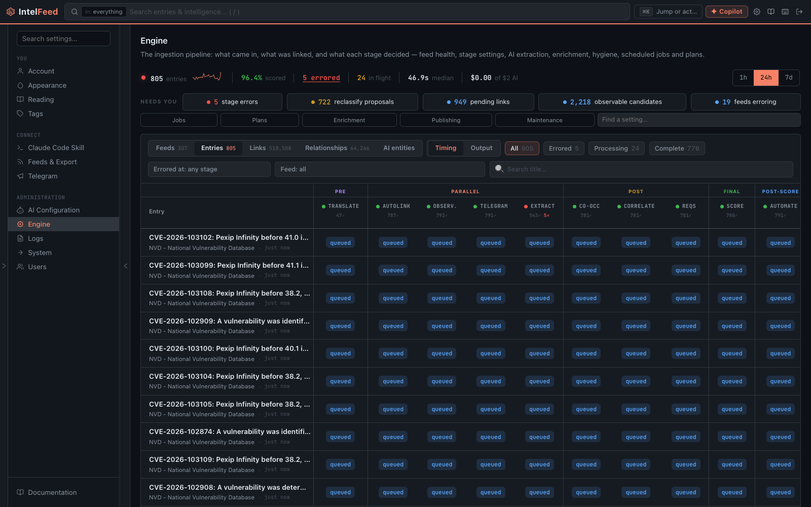

# When something isn't working

Ordered by how often it comes up.

*The Engine console shows what each pipeline stage decided for every entry.*

## A feed stopped producing

Feeds die quietly, and "no new articles" looks exactly like "a quiet week".

1. **Dashboard → Feed Activity / Feed Health** widgets. A bar that went to zero and stayed
   there is your answer.
2. **Settings → Engine → Feeds** (admin) for the definitive view: last
   successful fetch, error count, reliability.

Usual causes: the site moved its feed URL, a web scraper's target was
redesigned, or a credential expired. Fix the URL in the feed's settings; for a
scraper, check whether the site now offers a real feed and switch to it.

## An entity is linked to the wrong thing

"apt" in a sentence about package managers, a product name that's also an
ordinary word. Use the **Wrong?** control on the link in the reader and pick the
narrowest scope that's true — just this article, this alias anywhere, this
entity anywhere, or never link this word.

These are real corrections that change future linking, so the widest option is
not the safe default. See [Entities and profiles](entities.md).

## There are two pages for the same thing

Merge them from the **⋯** menu on either profile. Articles, relationships and
aliases are unioned onto the survivor. Admin-only, and same-type only.

If the *type* is wrong rather than there being a duplicate — something recorded
as a tool that is really a product — **convert** it instead of deleting. Convert
writes a tombstone so extraction doesn't recreate the wrong version within the
hour. Deleting doesn't, which is why the thing you deleted keeps coming back.

## An automation rule stopped firing

**Settings → Logs** shows every run. Two traps:

- Check the **per-action** status, not just the run's overall result. A run can
  report success with one action failing quietly inside it.
- Check whether the conditions still match. A rule keyed to a feed name breaks
  when the feed is renamed.

Before re-enabling anything you've edited, dry-run it. A notification rule that
fires per-article instead of per-batch will flood a channel.

## The copilot isn't answering

- **A sign-in banner in the dock** — the Claude sign-in expired. Admins can
  re-authenticate in-app at **Settings → AI Configuration**; no server access
  needed.
- **No provider assigned** — the copilot task needs a provider under
  **Settings → AI Configuration → Providers**.
- **Answers with no tool chips** — it answered from the model's own knowledge
  rather than your data. Ask it again, more specifically; if it still doesn't
  reach for tools, the provider may not support tool calling.

## Search returns nothing for something I can see

- Check the **scope chip** — it may be set to Workbench (entities only) or Feeds
  (articles only). **Tab** cycles it.
- Check the filter rail; filters you ticked earlier are written into the query
  and persist visibly in the box.
- If an article is genuinely missing from search, the index has drifted from the
  database. A nightly `reconcile-meilisearch` job repairs that on its own
  (07:15 UTC), and `retry-failed-indexing` retries individual failures every
  five minutes — so usually the answer is to wait. An admin can force it from
  **Settings → Engine → Jobs** with *Run now* on either job, or run
  `scripts/maintenance/reconcile_search_index.py` in the api container.

## A saved search shows the wrong count

Expected, and documented. The number is computed by a background job that skips
the intelligence half of the query, so any saved search built on an entity
filter shows a count you can't trust. **Opening it runs the real query and
returns the right results.** Counts are reliable for `tag:`, `feed:`,
`category:`, `type:`, `date:`, `is:` and plain text.

## Entity profiles are empty

Two different problems:

- **New instance** — profiles are cumulative. They're thin on day one and useful
  by the end of the month. This is not a fault.
- **Enrichment off** — CVE pages with no severity or KEV status mean the
  enrichment sources aren't enabled. An admin turns them on at
  **Settings → Engine**, enrich stage. NVD, EPSS and KEV are the three that
  matter most.

## The Priority Queue ranks badly for me

It's per-analyst and it learns, but it needs steering:

- **Watch** the entities you're actually responsible for, and **mute** the ones
  that are noise to you. This is the biggest lever and the most underused.
- **Write your intelligence requirements** at **Workbench → Requirements**. The
  PIR-match signal is the heaviest in the ranking and it's the one you configure.
- **Use the thumbs.** They adjust *your* signal weights.

Give it a couple of weeks before concluding it's wrong. See
[Priority Queue and watching](priority-queue.md).

## Images aren't loading

If the image proxy is on, the first view of an image is slower because it's
being cached. If an image on the source changed, you'll still see the cached
copy. Admins can clear the cache in System settings.

## Enrichment says rate limited

Each source has a rate-limit budget and requests beyond it are deferred and
retried, not dropped. NVD's public API is the usual culprit. If it's constant,
an admin can add an API key for that source under **Settings → Engine**.

## Still stuck

Ask the copilot on the [documentation home](/documentation) — it can search
these pages and the developer documentation. If the answer is genuinely about
how something is *built* rather than how to use it, point it at the reference
docs; it knows the difference.
