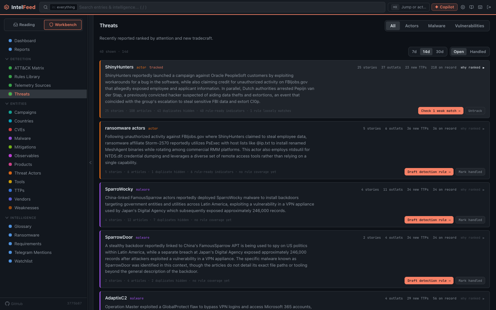
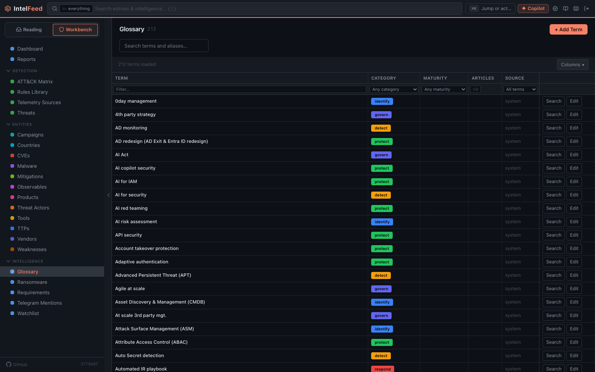

# The Workbench

Switch the sidebar to **Workbench** and you leave the inbox behind. This side of
the app is the intelligence you've accumulated, not the articles that arrived
today.

The nav opens with **Dashboard** and **Reports**, then groups into three blocks: Detection, Entities, Intelligence.

*The Threats board ranks recent activity by attention and new tradecraft.*

## Dashboard

The workbench landing page, and a customisable widget board.

Click **+** to add a widget, drag to place and resize it, and the layout saves
to your account. The time-range selector at the top drives every widget at once,
so the whole board answers "last 24 hours" or "last quarter" together.

There are boards as tabs, so you can keep a triage board and a reporting board
separate rather than cramming one.

There are 51 widgets in the picker. Worth having on a first board:

- **Triage Queue Stats** / **Unread Count** — your workload.
- **Trending Actors**, **Trending CVEs**, **Trending Malware** — what's moving
  this week. There are Trending widgets for TTPs, vendors and products too.
- **Feed Activity** and **Feed Health** — volume and fetch status per feed. This
  is how you notice a dead source.
- **KEV Deadlines** — known-exploited CVEs with their due dates. The closest
  thing to a "drop everything" widget.
- **ATT&CK Heatmap** / **ATT&CK Coverage Gap** — what you can detect, and what
  you can't.
- **New Detections** — what your team has actually shipped.
- **Under the Radar** — what the signal engine thinks is under-covered.
- **Morning Briefing** and **Weekly Recap** — narrative summaries, good for a
  handover.
- **PIR Coverage** — how well your feeds are serving your stated intelligence
  requirements. Uncomfortable, and useful.

## Reports

Top-level, next to Dashboard — it's a primary surface, not something to dig out
of a group. Build and publish intelligence products: exposure profiles, flash
alerts, actor dossiers, campaign trackers. See
[Campaigns and reports](campaigns-and-reports.md).

## Detection

**ATT&CK Matrix** — the technique grid, coloured by what you've seen and what
you can detect. The gap between those two is the useful reading.

**Rules Library** — every detection rule you hold, as a faceted table. See
[Writing detection rules](detection-rules.md).

**Telemetry Sources** — what log sources you actually collect. Filling this in
is what lets the app tell you a rule is unrunnable in your environment rather
than just valid.

**Threats** — the board covering what's active right now, ranked by story rather
than by outlet, so ten articles about one campaign are one row. Four tabs: All,
Actors, Malware and Vulnerabilities. The Vulnerabilities tab ranks CVEs by
exploitation and is where vendor and product exposure lives. Each row's button
names the job — draft a rule, extend one, adopt one — and the drawer shows its
working; see [The Threats board](threats-board.md).

## Entities

One browser per type: Campaigns, Countries, CVEs, Malware, Mitigations,
Observables, Products, Threat Actors, Tools, TTPs, Vendors and Weaknesses.

Each is a sortable, filterable table, and the columns are yours — pick which
ones show, reorder them, and the layout saves to your account. Clicking a row
opens the profile, covered in [Entities and profiles](entities.md).

These are the pages to use when the question starts from a *thing* rather than
from an article: "what do we have on this vendor", "which CVEs in our stack are
known-exploited", "what has this group been doing".

## Intelligence

**Glossary** — term definitions, including any house terms you add. This is what
the hover tooltips read from.

**Ransomware** — leak-site victim tracking as structured data rather than as
articles.

**Regions** — a card per region with its country count and article volume, a
quick read on where coverage is concentrated. It isn't in the Workbench nav: open
it from the command palette (**Regions & countries**), and open a single country
from the Countries browser under Entities.

**Requirements** — your standing intelligence requirements. Worth doing
properly: the *PIR match* signal in the [Priority Queue](priority-queue.md)
ranking is the one whose meaning you define.

**Telegram mentions** — what's being said in the channels you follow.

**Watchlist** — everything you're watching, in one place.

## Engine (admin only)

The Engine console lives at **Settings → Engine**, not in the Workbench nav; an
old `/workbench/engine` link redirects there.

It is one table that can show entries, links, relationships, AI-extracted
entities or feeds, with the settings for each pipeline stage in place, plus
**Jobs** for background schedules and recent runs, **Plans** for stage
composition, **Maintenance** for the cleanup sweeps, and **Publishing** for the
outbound indicator feeds.

This is where an admin goes when something isn't working — a feed that stopped,
extraction producing junk, enrichment rate-limited — and where enrichment
sources and their API keys are configured. Day to day, most users never open it.
Every setting it exposes is catalogued in
[engine-settings.md](../engine-settings.md).

*The Glossary maps terms to the articles that use them, so a term is a starting point for a search.*
