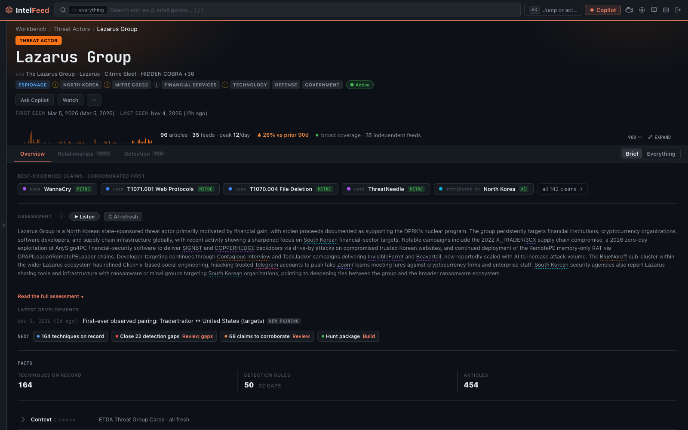
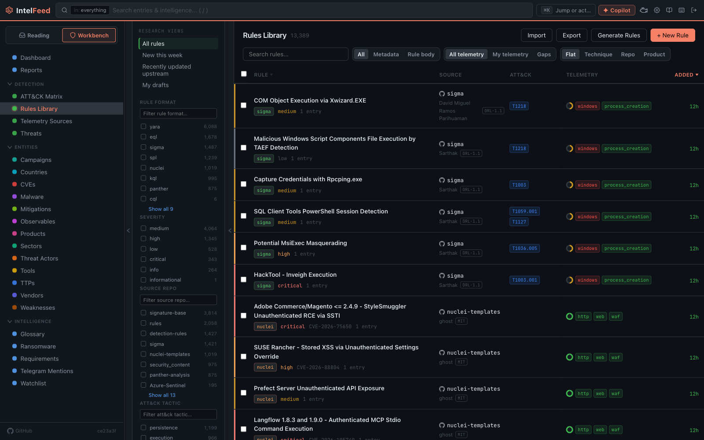

<p align="center">
  
</p>

<p align="center">
A self-hosted, security-focused RSS aggregator and threat intelligence platform. Built for security
analysts and detection engineers to consume threat feeds, extract TTPs/CVEs, correlate entities, and
generate detection rules or reports.
</p>

<p align="center">
  <a href="https://github.com/a-oneil/IntelFeed/actions/workflows/ci.yml"></a>
  <a href="LICENSE"></a>
</p>

<p align="center">
  
</p>

---

## What it is

Most security teams read threat intel in a feed reader and lose it there. An article about a new
loader mentions three malware families, a CVE, and five ATT&CK techniques — and none of that survives
past the browser tab.

IntelFeed is a reader that keeps the intelligence. It ingests the sources you already follow — RSS,
YouTube, Reddit, GitHub, NVD, Mastodon, Bluesky, Telegram, arbitrary web pages — and, as each article
lands, links it to the threat actors, malware, tools, CVEs, ATT&CK techniques, vendors, products, and
countries it actually mentions. Those links accumulate into entity profiles you can pivot through,
a relationship graph you can interrogate, and a corpus you can turn into detection content.

It runs entirely on your own hardware. There is no SaaS backend, no telemetry, and no vendor holding
your collection.

## What it does

**Collection**
- Adapters for RSS/Atom, YouTube, podcasts, Reddit, GitHub releases and repos, the NVD CVE feed,
  Mastodon, Bluesky, Telegram channels, and a generic web scraper
- Conditional GET, content dedup, full-article fetch for truncated feeds, OPML import/export
- Optional article translation (LibreTranslate) and server-side read-aloud (Piper TTS)

**Intelligence extraction**
- Aho–Corasick autolinking of entries against a live vocabulary of actors, malware, tools, CVEs,
  ATT&CK techniques, vendors, products, and countries
- Entity resolution guardrails: junk-alias filtering, cross-type resurrection tombstones, and an
  AI-confirmation tier for ambiguous dictionary-word matches
- Typed entity relationships governed by a semantic matrix and a provenance trust ladder
  (MITRE-sourced → asserted → AI-adjudicated), so the graph stays defensible

**Analysis**
- Correlation and pivots across entity types via shared entries, with paragraph-proximity scoring
- Entity dossiers, campaigns, timelines, and an interactive relationship graph
- A signal engine that scores every entry (IDF-weighted novelty, CVE exploitation events, domain
  convergence) and surfaces a ranked priority queue instead of a reverse-chronological wall
- Ransomware leak-site victim tracking, CVE enrichment (NVD, EPSS, affected CPE products), and
  exposure views

**Detection engineering**
- Rule extraction in six formats — Sigma, Splunk SPL, Elastic QL, KQL, YARA, Snort/Suricata — with
  per-format syntax validation and source provenance back to the article
- A rule library and workbench, detection-gap analysis, telemetry-source mapping, ATT&CK coverage
  and Navigator layer export
- Research bundles: per-entry markdown, IOC CSV, and an ATT&CK layer in one ZIP

**Automation & AI**
- Automation rules (triggers → conditions → actions) for tagging, filtering, notifications, AI tasks,
  and Priority Intelligence Requirement matching
- Watchlists, scheduled briefings, and Slack / Discord / Teams / webhook delivery
- A model-agnostic AI provider layer (Ollama, the Claude API, the Claude Code CLI, or any
  OpenAI-compatible endpoint — OpenAI, LM Studio, vLLM, llama.cpp, LiteLLM, OpenRouter, Groq)
  with an editable prompt workspace, per-task model routing, and cost tracking
- An in-app copilot with streaming tool traces that can query and act on your own instance

**Working with it**
- Meilisearch-backed full-text search with a purpose-built query language, saved searches, and a
  command palette
- Configurable dashboards and widgets, a three-panel reader, runtime-switchable themes
- Export to CSV and Markdown; outbound observable feeds (EDL blocklists, SIEM lookups, TAXII 2.1); token-gated public RSS re-publishing; shareable public links to articles and copilot conversations
- REST API covering every feature, plus a zero-dependency CLI (196 tools) for scripting and agents

## What it looks like

**Read, and keep what you read.** Open an article and the entities it mentions are already linked —
actors, malware, CVEs, techniques — with an extracted summary above the text.


**A queue that ranks stories, not outlets.** The Priority Queue folds duplicate coverage of the same
event into one story card, scored by how much it probably matters to you.


**Entity profiles that accumulate.** Every article that mentions an actor feeds its profile: claims
ranked by evidence, a coverage sparkline, detection gaps, and the reading that matters.



**A board of what's actually moving.** Threats ranks recent activity by attention and new tradecraft,
with a one-click path from a threat to a drafted detection rule.


**One search box over everything.** Articles and entities in one result set, with a facet rail to
narrow by type, malware family, actor, or detection rule.


**Detection content as a first-class library.** Rules across nine formats (the six above, plus CrowdStrike QL, Nuclei and Panther), filterable by telemetry you
actually have, with coverage gaps called out.



**A dashboard you arrange.** Widgets for triage flow, the morning briefing, under-the-radar items, and
entity counts, on a grid you lay out yourself.


## Who it's for

- **Threat intel analysts** who want their reading to compound into a searchable, pivotable
  collection rather than a bookmark pile.
- **Detection engineers** who want to get from "this blog post describes a technique" to a validated
  Sigma or SPL rule — with the source article still attached — in one place.
- **Small teams and solo practitioners** who need TIP-shaped workflows without a commercial TIP,
  and who would rather keep their sources and analysis on their own box.

It is deliberately a *self-hosted single-tenant* tool: multi-user, but scoped to one organization.
It serves a minimal read-only TAXII 2.1 collection of its observables, but it is not a replacement for MISP — it happily sits
upstream of one.

## Quick start

Requirements: Docker and Docker Compose.

```bash
git clone https://github.com/a-oneil/IntelFeed.git intelfeed
cd intelfeed
cp .env.example .env
```

Generate the secrets `.env` needs, then fill them in:

```bash
openssl rand -hex 32                     # SECRET_KEY
openssl rand -base64 32 | tr '+/' '-_'   # ENCRYPTION_KEY (a Fernet key)
openssl rand -hex 24                     # POSTGRES_PASSWORD, MEILI_MASTER_KEY
```

Then bring the stack up:

```bash
docker compose -f docker-compose.dev.yml up
```

Open <http://localhost:3001> and register the first account — it becomes the admin. Migrations run
automatically on API startup, and the first boot seeds AI tasks, enrichment sources, and defaults.
The API is on <http://localhost:8000> (`/docs` for Swagger).

Then seed the reference data the intelligence engine matches against — the CWE catalog, vendors
and products, CPE curation, threat-actor attribution, and a fuller ATT&CK set. Migrations only load
countries and a baseline of ATT&CK techniques, so without it most entity types never link:

```bash
docker compose -f docker-compose.dev.yml exec api python scripts/seed/seed_all.py
```

Then give it something to read. The onboarding wizard's first step offers curated **starter feed
packs** that ship with the build — a 37-feed **Core** set (security news, government and CERT
advisories, NVD and vendor bulletins, the best vendor research and detection-engineering sources),
plus optional add-ons per category. Nothing is created until you pick. For a scripted install:

```bash
docker compose -f docker-compose.dev.yml exec api python scripts/seed/seed_feeds.py --list
docker compose -f docker-compose.dev.yml exec api python scripts/seed/seed_feeds.py            # core only
docker compose -f docker-compose.dev.yml exec api python scripts/seed/seed_feeds.py --all       # everything
```

From there, add feeds under **Settings → Feeds & Export** or import an OPML file, and configure an AI provider
under **Settings → AI Configuration** if you want summarization and extraction. Nearly everything
else — thresholds, enrichment API keys, rate limits, the image proxy — is editable at runtime under
**Settings → Engine** (backups and monitoring are under **Settings → System**); the database-backed
settings table takes precedence over `.env`, so env vars act as defaults.

For a production deployment (any Linux host, Caddy auto-TLS, DNS, seeding, data migration), see [setup.md](setup.md).

## Documentation

Full documentation lives in [`docs/`](docs/) — [`docs/README.md`](docs/README.md) is the guided index.
It also renders inside the app at **/documentation**.

Start here depending on what you're doing:

| I want to… | Read |
| --- | --- |
| Use IntelFeed day to day | [User guide](docs/guide/README.md), [Query language](docs/query-language.md) |
| Run it in production | [Operations](docs/operations.md), [setup.md](setup.md) |
| Wire it into other tools | [Integrations](docs/integrations.md), [API reference](docs/api-reference.md), [CLI reference](docs/cli-reference.md) |
| Work on the code | [Architecture](docs/architecture.md), [Contributing](contributing.md) |

## Support

IntelFeed is maintained in spare time. Issues and pull requests are welcome and get a best-effort
reply, with no guaranteed response time. Report security problems privately: see
[security.md](security.md).

## Contributors

Thanks to everyone who has put work into IntelFeed:

<table>
  <tr>
    <td align="center" valign="top" width="160">
      <a href="https://github.com/a-oneil"><br><b>a-oneil</b></a><br>
      Creator and maintainer
    </td>
    <td align="center" valign="top" width="160">
      <a href="https://github.com/kwolfe22"><br><b>Kurt Wolfe</b></a><br>
      Android app, MCP server, per-user tags, Priority Queue, docs
    </td>
    <td align="center" valign="top" width="160">
      <a href="https://github.com/samir-elhelw76"><br><b>samir-elhelw76</b></a><br>
      OpenAI-compatible AI provider
    </td>
  </tr>
</table>

This list is kept by hand. If you contribute, add yourself to it in your pull request.

## Built with Claude

IntelFeed was built end-to-end with [Claude](https://claude.ai). Every line of it — backend,
frontend, migrations, tests, and this documentation — was written by Claude over months of
day-to-day direction, testing, correction, and real operational use by its human maintainer, who ran
the platform against live threat feeds throughout and fed the results back into the next iteration.

Worth knowing if you are evaluating the codebase, contributing to it, or judging how much to trust it
in your own environment.

## Tech stack

Python 3.14 · FastAPI · SQLAlchemy (async) · Alembic · Celery + Redis · PostgreSQL 16 · Meilisearch ·
React 19 · TypeScript · Vite · TanStack Query + Zustand · Docker Compose · Caddy

## Acknowledgements

IntelFeed depends on a lot of open-source software and public threat data. Thank you to the
projects and teams below. Articles shown in IntelFeed belong to the sites that published them.

**Open-source projects**

- [Meilisearch](https://github.com/meilisearch/meilisearch) powers search
- [pgvector](https://github.com/pgvector/pgvector) groups related articles into story threads
- [Piper](https://github.com/OHF-Voice/piper1-gpl) reads articles aloud
- [LibreTranslate](https://github.com/LibreTranslate/LibreTranslate) translates foreign-language articles
- [Ollama](https://github.com/ollama/ollama) runs AI models locally
- [PostgreSQL](https://www.postgresql.org), [Redis](https://redis.io) and [Caddy](https://caddyserver.com) are the database, task queue and web server

**Data sources**

Entity profiles, CVE details and indicator lookups are filled in from the sources below. Each one
has its own license or terms of use. The ones marked *non-commercial* are free only for
non-commercial use. Sources that need an API key stay off until you add one in
Settings › Engine › Enrichment.

| Source | What IntelFeed uses it for | Terms |
| --- | --- | --- |
| [MITRE ATT&CK®](https://attack.mitre.org) | Techniques, groups, software and their relationships | [ATT&CK terms of use](https://attack.mitre.org/resources/legal-and-branding/terms-of-use/) |
| [CVE Program](https://www.cve.org) (cvelistV5) | CVE records | [CVE terms of use](https://www.cve.org/Legal/TermsOfUse) |
| [NVD](https://nvd.nist.gov) | CVSS scores, weaknesses and affected products | [NVD terms of use](https://nvd.nist.gov/developers/terms-of-use) |
| [MITRE CWE™](https://cwe.mitre.org) | Weakness catalog | [CWE terms of use](https://cwe.mitre.org/about/termsofuse.html) |
| [CISA KEV](https://www.cisa.gov/known-exploited-vulnerabilities-catalog) | Known exploited vulnerabilities | Public domain |
| [VulnCheck KEV](https://vulncheck.com/kev) | Known exploited vulnerabilities | VulnCheck community terms |
| [FIRST EPSS](https://www.first.org/epss/) | Exploit prediction scores | FIRST EPSS terms |
| [OSV.dev](https://osv.dev) | Affected packages and fixed versions | CC BY 4.0 |
| [Malpedia](https://malpedia.caad.fkie.fraunhofer.de) (Fraunhofer FKIE) | Malware and actor profiles | CC BY-NC-SA 3.0, *non-commercial* |
| [MISP Galaxy](https://github.com/MISP/misp-galaxy) | Threat-actor countries, motives and targeted sectors | CC0 1.0 or BSD 2-Clause |
| [Metasploit Framework](https://github.com/rapid7/metasploit-framework) | Which CVEs have a Metasploit module | BSD 3-Clause |
| [ransomware.live](https://www.ransomware.live) | Leak-site victims, group profiles | ransomware.live API terms, *non-commercial* |
| Cybergeist | Actor and malware profiles | No published license, *non-commercial* |
| [abuse.ch](https://abuse.ch) | Malware, URL and IOC lookups | abuse.ch terms, *non-commercial* |
| [GreyNoise](https://www.greynoise.io) | IP context | GreyNoise Community terms, *non-commercial* |
| [Shodan InternetDB](https://internetdb.shodan.io) | IP ports and tags | Free for non-commercial use |
| [VirusTotal](https://www.virustotal.com) | File, URL and domain lookups | VirusTotal public API terms, *non-commercial* |
| [CVEdetails](https://www.cvedetails.com) | A second view of CVE exploit and scoring data | CVEdetails API subscription, *non-commercial* |
| [Team Cymru](https://www.team-cymru.com/ip-asn-mapping) | IP-to-ASN mapping | Free service |
| [RDAP](https://rdap.org) | Domain registration data | Each registry's terms |
| [Tranco](https://tranco-list.eu) | Popular-domain list, to skip benign domains | Inputs under CC BY 3.0, CC BY-SA 4.0 and CC BY 4.0 |
| [Wikipedia](https://www.wikipedia.org) and [Wikidata](https://www.wikidata.org) | Vendor and entity descriptions | CC BY-SA 4.0 / CC0 |
| [GitHub](https://github.com) | Proof-of-concept repositories | GitHub terms of service |

Required notices:

- ATT&CK® content © The MITRE Corporation, reproduced and distributed with the permission of The
  MITRE Corporation.
- CVE® records © The MITRE Corporation. CWE™ is a trademark of The MITRE Corporation.
- This product uses the NVD API but is not endorsed or certified by the NVD.
- Tranco: V. Le Pochat et al., "Tranco: A Research-Oriented Top Sites Ranking Hardened Against
  Manipulation," NDSS 2019.

## License

Copyright (C) 2026 a-oneil

IntelFeed is free software: you can redistribute it and/or modify it under the
terms of the [GNU Affero General Public License](LICENSE) as published by the
Free Software Foundation, either version 3 of the License, or (at your option)
any later version. It is distributed in the hope that it will be useful, but
WITHOUT ANY WARRANTY; without even the implied warranty of MERCHANTABILITY or
FITNESS FOR A PARTICULAR PURPOSE. See the GNU AGPL for more details.

In short: you are free to run, study, modify, and share it. If you run a modified
version as a network service, the AGPL requires you to offer those modifications
to its users under the same license.
